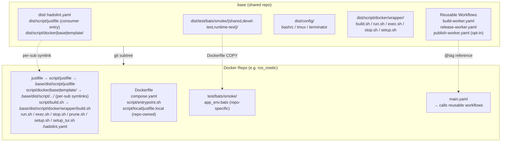
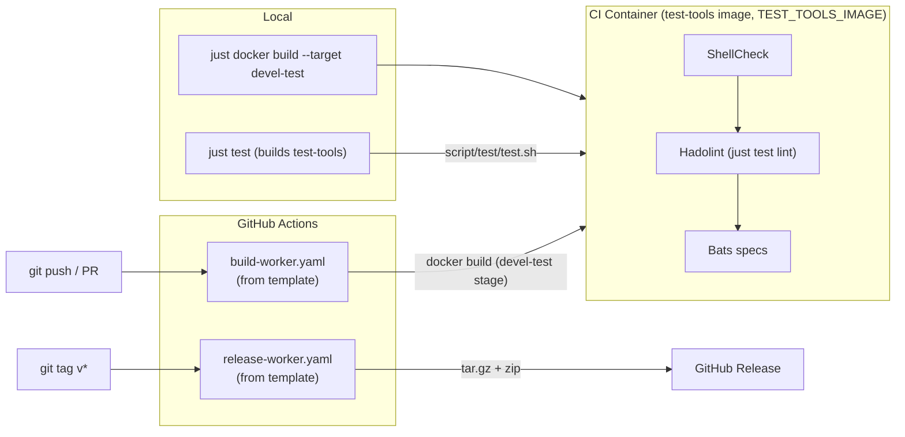

# base

[](https://github.com/ycpss91255-docker/base/actions/workflows/self-test.yaml)


[](./LICENSE)

Shared template for Docker container repos in the [ycpss91255-docker](https://github.com/ycpss91255-docker) organization.

**[English](README.md)** | **[繁體中文](doc/readme/README.zh-TW.md)** | **[简体中文](doc/readme/README.zh-CN.md)** | **[日本語](doc/readme/README.ja.md)**

---

## Table of Contents

- [TL;DR](#tldr)
- [Prerequisites](#prerequisites)
- [Overview](#overview)
- [Everyday use](#everyday-use)
- [Per-repo runtime configuration](#per-repo-runtime-configuration)
- [Upgrading](#upgrading)
- [CI Reusable Workflows](#ci-reusable-workflows)
- [Development and tests](#development-and-tests)
- [Directory Structure](#directory-structure)

---

## TL;DR

```bash
# New repo from scratch: first commit + subtree + one-time bootstrap
mkdir <repo_name> && cd <repo_name>
git init
git commit --allow-empty -m "chore: initial commit"
git subtree add --prefix=.base \
    https://github.com/ycpss91255-docker/base.git vX.Y.Z --squash
./.base/dist/script/base/init.sh   # one-time bootstrap; thereafter: just base init

# Upgrade
just base update    # is a newer tag available?
just base upgrade   # subtree pull + resync + workflow refs (see Upgrading)

# Use
just docker build   # build the image (setup.sh runs first when needed)
just docker run     # start the devel container
just                # list every namespace
```

`git subtree add` needs `HEAD` to exist. On a freshly `git init`-ed repo
with no commits it fails with `ambiguous argument 'HEAD'` and `working tree
has modifications`; the empty commit creates `HEAD` so subtree can merge
into it.

## Prerequisites

Container operations run through [`just`](https://github.com/casey/just) (the
command runner) layered on Docker. Install both on the host before using the
`just <verb>` entry point:

- **Docker** + Docker Compose v2 (`docker compose`).
- **just** -- this repo PINS one version. The test-tools image, CI and the
  `--bootstrap-just` installer all run that exact version, so a recipe behaves
  the same in all three places; print it with
  `./.base/dist/script/base/just-version.sh` (in this repo,
  `./dist/script/base/just-version.sh`). Install exactly that version with the
  official prebuilt-binary installer, which takes a version:

  ```bash
  pin="$(./.base/dist/script/base/just-version.sh)"
  curl --proto '=https' --tlsv1.2 -sSf https://just.systems/install.sh \
      | bash -s -- --to ~/.local/bin --tag "${pin}"
  ```

  A host package manager (`apt install just`, `brew install just`,
  `cargo install just`) is a **fallback, not an equivalent**: it installs
  whatever version its own registry carries, which may be many minors behind
  the pin. See the [official install
  guide](https://github.com/casey/just#installation) for every method. If
  `just` is unavailable each recipe has a raw fallback
  (`./script/<verb>.sh`, `./.base/dist/script/base/upgrade.sh`) -- see
  [Upgrading](#upgrading).

## Overview

This repo consolidates shared scripts, tests, and CI workflows used across all Docker container repos. Instead of maintaining identical files in 15+ repos, each repo pulls this template as a **git subtree** and uses symlinks. A visual tour lives in [doc/arch/overview.html](doc/arch/overview.html).

### Architecture



### CI/CD Flow



### What's included

| File | Description |
|------|-------------|
| `script/build.sh` | Build containers (TTY-aware `--setup` launches `setup_tui.sh`, else runs `setup.sh`) |
| `script/run.sh` | Run containers (X11/Wayland support; same `--setup` semantics as `build.sh`; `--build` opt-in pre-flight `./script/build.sh test` for fresh-clone CI parity) |
| `script/exec.sh` | Exec into running containers |
| `script/stop.sh` | Stop and remove containers |
| `script/prune.sh` | Prune dangling images / build cache for the repo |
| `script/setup_tui.sh` | Interactive setup.toml editor (dialog / whiptail front-end) |
| `dist/script/docker/wrapper/setup.sh` | Auto-detect system parameters and generate `.env` / `.env.generated` + `compose.yaml` |
| `dist/script/docker/lib/_lib.sh` | Core wrapper library (`_load_env`, `_compose`, `_compose_project`, ...) |
| `dist/script/docker/lib/bootstrap.sh` | Common wrapper initialization and arg parsing |
| `dist/script/docker/lib/compose.sh` | `docker compose` invocation wrapper + project naming |
| `dist/script/docker/lib/compose_emit.sh` | `compose.yaml` renderer |
| `dist/script/docker/lib/conf.sh` | setup.toml read/write (TOML; legacy INI for migration) |
| `dist/script/docker/lib/toml_bridge.sh` | TOML parser bridge (native or containerised) |
| `dist/script/docker/lib/config_gen.sh` | Shell side of the Go config generator ([ADR-00000039](doc/adr/00000039-config-generator-in-go.md)) |
| `dist/script/docker/lib/conf_logging.sh` | Logging configuration helpers |
| `dist/script/docker/lib/env.sh` | Environment variable setup and defaults |
| `dist/script/docker/lib/gitignore.sh` | Gitignore file management |
| `dist/script/docker/lib/hook.sh` | Per-wrapper pre/post hook invocation |
| `dist/script/docker/lib/i18n.sh` | Language detection and localization (`_detect_lang`, `_LANG`) |
| `dist/script/docker/lib/log.sh` | Unified logging and output utilities |
| `dist/script/docker/lib/config_summary.sh` | Summary of runtime configuration |
| `dist/script/docker/lib/_tui_backend.sh` | dialog/whiptail wrapper functions used by `setup_tui.sh` |
| `dist/script/docker/lib/_tui_conf.sh` | setup.toml value validators (shared by `setup_tui.sh` and `setup.sh`) |
| `dist/script/docker/runtime/logging.sh` | Host-side log tee helper (per-start file + stable symlink) |
| `dist/script/docker/runtime/logrotate.sh` | Shared rotate/symlink/prune primitives (tee + transcript) |
| `dist/script/docker/runtime/watchdog.sh` | Generic single-service watchdog (restart + pluggable health check) |
| `dist/script/docker/runtime/entrypoint.sh` | base's ENTRYPOINT orchestrator: opens the log tee, sources the repo bringup, arms the watchdog, execs the workload |
| `dist/dockerfile/entrypoint.sh` | Bringup template, seeded into a new repo as `script/entrypoint.sh` (the repo's half, sourced by the orchestrator) |
| `dist/test/bats/smoke/smoke.sh` | Runtime install-check smoke (ldd missing-dep scan) |
| `script/test/test.sh` | base self-test dispatcher (local + in-container) |
| `script/test/drivers/` | One driver per lint/test tool |
| `script/test/lint_bare_stderr.sh` | Bare stderr lint checker |
| `config/` | Container-internal shell configs (bashrc, tmux, terminator) |
| `setup.toml` | Single per-repo runtime configuration (image / build / deploy / gui / network / volumes) |
| `dist/test/bats/smoke/` | Shared smoke tests + runtime assertion helpers ([dockerfile-stages.md](doc/guide/dockerfile-stages.md#smoke-test-helpers-for-downstream-repos)) |
| `test/bats/unit/` | base self-tests, Unit level (bats + kcov) |
| `test/bats/integration/` | base self-tests, Integration level (init/upgrade end-to-end) |
| `test/bats/system/` | base self-tests, System level / Regression (runtime smoke gate, opt-in) |
| `test/bats/acceptance/` | base self-tests, Acceptance level (UAT/OAT; reserved, S5 #785) |
| `.hadolint.yaml` | Shared Hadolint rules |
| `justfile` (→ `script/justfile`) | Repo entry — layered namespaced recipes (`just docker build`, `just docker run`, `just test`, `just base upgrade`, etc.). Sub-cmds and flags are forwarded verbatim (`"$@"`), e.g. `just docker build --no-cache --target devel`; bare `just` lists all namespaces. |
| `dist/script/docker/justfile.docker` | `docker` namespace — container ops (`just docker build/run/start/exec/stop/prune/setup/setup-tui`). |
| `dist/script/base/justfile.base` | `base` namespace — manage the `.base` subtree (`just base init/update/upgrade/completions`). |
| `dist/script/base/init.sh` | First-time symlink setup + new-repo scaffolding (bootstrap: `./.base/dist/script/base/init.sh`; thereafter `just base init`). |
| `dist/script/base/upgrade.sh` | Subtree version upgrade (`just base upgrade [vX.Y.Z]`). |
| `script/test/justfile.test` | base self-test entry (`just test`, `just test lint`, `just test coverage`, …). |
| `script/release/justfile.release` | base `release` namespace (release / publish tooling). |
| `script/watch/justfile.watch` | base `watch` namespace — upstream-release watch (`just watch`, `just watch pins`, `just watch bump <name> <version>`). |
| `dist/dockerfile/Dockerfile` | Multi-stage Dockerfile template for new repos |
| `dockerfile/Dockerfile.test-tools` | Pre-built lint/test tools image (shellcheck, hadolint, bats, kcov) |
| `dockerfile/Dockerfile.config-gen` | Builds the Go config generator (`config-gen`; provisioning only, `compose_emit.sh` still renders `compose.yaml`) |
| `dockerfile/config-gen/go.mod` | The Go config generator module ([ADR-00000039](doc/adr/00000039-config-generator-in-go.md)) |
| `.github/workflows/` | Reusable workers + base CI |

Test content is laid out **tool-first** -- `test/<tool>/<category>/`
for specs (e.g. `test/bats/unit/`) and `test/lint/<tool>/` for linters --
so adding a tool is a new folder, not a new command surface. The category
vocabulary is ISTQB-aligned (levels Unit / Integration / System /
Acceptance + the Smoke type); see
[ADR-00000018](doc/adr/00000018-istqb-test-taxonomy.md) and
[ADR-00000012](doc/adr/00000012-tool-first-test-layout.md) (supersedes the
category-first ADR-00000004). A consumer ships its own `test/bats/smoke/`; base
ships its own `test/bats/{unit,integration,system,acceptance}/`.

### What stays in each repo (not shared)

- `Dockerfile`
- `compose.yaml`
- `script/` — repo-local runtime helpers (invoked inside the container by `ENTRYPOINT` / `CMD` or by hand)
  - `script/entrypoint.sh` — the repo's **bringup**, sourced by base's orchestrator; it is not the `ENTRYPOINT` itself (see [entrypoint.md](doc/guide/entrypoint.md))
  - any ros / app launch helpers etc.
- `script/docker/` — repo-local Dockerfile-internal build helpers (invoked from a Dockerfile `RUN`, never inside a running container; see commented stub + lint COPY in `dist/dockerfile/Dockerfile`, #275)
- `doc/` and `README.md`
- Repo-specific smoke tests

## Everyday use

### Getting help (namespace vs recipe)

`just` help works at two levels; the dashed `just <ns> --help` form is a
documented `just` dispatch limitation, not a bug:

| You want | Use | Notes |
|---|---|---|
| List a namespace's recipes | `just <ns> help` (`just <ns> h`) | e.g. `just docker help`, `just base help`. **Localised**: renders each recipe's one-line summary in your language (`$LANG`, or `--lang <en\|zh-TW\|zh-CN\|ja>`) for the `docker` / `base` / `template` namespaces. Bare `just <ns>` lists too, but stays English. |
| Help for one recipe | `just <ns> <recipe> --help` | e.g. `just docker build --help`, `just base upgrade --help`, `just base update --help` -- `--help` is forwarded to the backing script. |
| List every namespace | `just` | Top-level overview. `just --list` (and bare `just <ns>`) stay English -- just's native listing cannot be intercepted; `just <ns> help` is the translated entry point. |
| `just <ns> --help` | (avoid) | A dashed name cannot be a `just` recipe/alias, so this cannot be intercepted; `just` prints `Did you mean 'help'?` and points you at `just <ns> help`. |

### Wrapper UX cheat sheet (#291)

Single canonical reference for what each user-facing script accepts.
Downstream READMEs link here instead of duplicating the table. Each
`just docker <verb>` forwards its arguments to `./script/<verb>.sh`.

| Flag / form | `build.sh` | `run.sh` | `exec.sh` | `stop.sh` | `setup.sh` (CLI) |
|---|:---:|:---:|:---:|:---:|:---:|
| `-h` / `--help` | yes | yes | yes | yes | yes |
| `-C` / `--chdir DIR` | yes | yes | yes | yes | — |
| `--lang LANG` | yes | yes | yes | yes | yes |
| `--dry-run` | yes | yes | yes | yes | — |
| `-s` / `--setup` | yes | yes | — | — | — (target of `--setup`) |
| `-t` / `--target TARGET` | yes (#280, alias to positional) | yes | yes | — (Q2: stays project-wide) | — |
| `-q` / `--quiet` | — | — | — | — | yes (#285, on mutating subcommands) |
| `--gui auto\|force\|off` | yes (#338) | yes (#338) | — | — | yes (apply, #338) |
| `--no-x11-cookie` | yes (#338) | yes (#338) | — | — | yes (apply, #338) |
| `--print-resolved` | — | — | — | — | yes (apply, #338) |
| `--` separator | — | yes | yes (#289) | — | yes (per subcommand) |
| Positional meaning | TARGET | CMD | CMD | `docker compose down` pass-through | subcommand name |

The three shape decisions behind the table (positional plus `-t` on
`build.sh`, no `-t` on `stop.sh`, subcommand-first `setup.sh`) are recorded
in [ADR-00000040](doc/adr/00000040-wrapper-cli-shape.md).

## Per-repo runtime configuration

Each downstream repo drives its runtime config — GPU reservation, GUI
env/volumes, network mode, extra volume mounts — through a single
`setup.toml` file. `setup.sh` reads it (plus system detection) and
regenerates `.env`, `.env.generated` and `compose.yaml`; users never
hand-edit those derived artifacts. `.env.local` is the different file: setup
scaffolds it once and never rewrites it, and it is where your own values go.

The files fall into three groups:

- **Regenerated** on every `setup.sh apply`: `compose.yaml`,
  `.env.generated` and `.env`. Never hand-edit them.
- **Repo-owned, never overwritten**: `setup.toml` and `Dockerfile`. The
  tooling writes `setup.toml` only when you ask it to (`just docker setup
  set`, the TUI); an upgrade's named migrations are listed in
  [What upgrade.sh rewrites](#what-upgradesh-rewrites-in-your-repo).
- **Local**, gitignored and yours: `setup.local.toml` and `.env.local`.

`.env.generated` keeps its suffix for a different reason -- it feeds
compose's `${VAR}` interpolation and never enters a container, so the
suffix marks a category, not ownership.

On the first `setup.sh` run (no per-repo `setup.toml` yet), the template
file is copied to `<repo>/setup.toml` and the detected workspace is written
to the **first `[[volumes]]` block** — the block `volumes.mount_1`
addresses. Subsequent runs read `mount_1` as source of truth; clear it to
opt out of mounting a workspace. `./.base/dist/script/base/init.sh
--gen-conf` makes the same plain copy, refusing if the file exists
(`--force` backs it up to `setup.toml.bak`).

### One conf, 15 sections

The section list below is not prose: it is `SCHEMA_SECTIONS`
(`dist/script/docker/lib/schema.sh`), the single source for which sections
exist and in what order, and the `derived-figures` lint fails if this block
or its count drifts from it.

```
[project]  name — the compose project this checkout runs under (empty =
           derive <DOCKER_HUB_USER>-<IMAGE_NAME>). Set it per WORKTREE in
           setup.local.toml to run two checkouts at once
[image]    rules = prefix:docker_, suffix:_ws, @basename
[build]    apt_mirror_ubuntu, apt_mirror_debian            # Dockerfile build args
[deploy]   gpu_mode (auto|force|off), gpu_count, gpu_capabilities
           dri_groups (auto|off) — iGPU /dev/dri group_add on GUI svcs
[lifecycle] restart (no|always|unless-stopped|on-failure|on-failure:N)
           default unless-stopped; DEPLOY-scoped — see
           doc/guide/lifecycle.md. init (true|false) — Docker init/PID1
           reaper; default true. watchdog_* — in-container health probe, opt-in
[gui]      mode (auto|force|off)
[network]  mode (host|bridge|none), ipc, pid (host|private), privileged
           port_N = host:container (published only under bridge)
[security] privileged (false), cap_add_N, cap_drop_N, security_opt_N
           (+ the matching *_inherit toggles; opt-in, lean by default)
[resources] shm_size
[environment] env_N = KEY=VALUE — set-once defaults, written to the
           generated .env and baked as ENV into a deployable stage;
           volatile per-task vars go in .env.local instead
[tmpfs]    tmpfs_N = /path[:size=N] — RAM-backed mount points
[devices]  device_N = host:container, plus cgroup rules (opt-in)
[volumes]  mount_1 (workspace, auto-populated on first run)
           mount_2..mount_N (extra host mounts; devices via /dev path)
[additional_contexts] context_N = name=source — extra named build contexts
[logging]  driver (json-file default), max_size, max_file, compress
           local_path (host-side log dir; bind-mounted to /var/log/<repo>)
           container_log_keep (20), container_log_days (14) (per-start
           container-log retention; keep-count AND age, stricter wins)
           wrapper_transcript (tee verbs to log/<verb>/; default true),
           wrapper_transcript_keep (20), wrapper_transcript_days (14)
           [logging.<svc>] for per-service key-level override
```

The bracket names above are the section roster, not the file's syntax. A
scalar section is a TOML `[table]`; a list-shaped one is an
`[[array of tables]]`, and its N-th block is what `<prefix>_N` addresses --
`volumes.mount_1` is the first `[[volumes]]` block.

Template default lives at `.base/dist/setup.toml`; per-repo overrides go
at `<repo>/setup.toml` (tool-managed by `just docker setup`, kept out of the
hand-editable `config/` surface). Merge is **type-aware**
([ADR-00000037](doc/adr/00000037-toml-config-format-unification.md)): scalar
keys inside a `[table]` merge key-level -- the highest layer that defines a
key wins it, and keys it does not mention inherit from the layer below --
while an `[[array of tables]]` is replaced whole by the highest layer that
defines it. Sections no layer mentions fall through.

#### Three layers: the third is yours (`setup.local.toml`)

| Layer | Tracked | Whose it is |
|---|---|---|
| `.base/dist/setup.toml` | shipped in the subtree | base's default |
| `<repo>/setup.toml` | committed | the repo's -- what CI and every other checkout use |
| `<repo>/setup.local.toml` | **gitignored** | yours, on this machine, in this worktree |

Same grammar, same type-aware merge rule, at every step. Write the third
one with `--local`:

```bash
just docker setup set --local project.name myrepo-wt2
```

A list is replaced whole rather than merged entry by entry, because a
half-override of an ordered list could never remove an item and would
assemble combinations neither layer wrote. Three things follow, all of them
loud rather than silent:

- Writing a section with plain `set` while `setup.local.toml` defines it
  **warns** and names the section. It is not refused -- the value is still
  the committed one CI and other checkouts use -- but it will not change
  anything on this machine.
- Every wrapper's pre-run summary carries a `local override:` row naming
  the file and the sections it replaces.
- `just docker setup deploy` **refuses** while the file exists (see
  [field-deploy.md](doc/guide/field-deploy.md)).

### Topic guides

Each deep topic lives on its own page under `doc/guide/` (English only;
this README is authoritative):

- [Dockerfile stages](doc/guide/dockerfile-stages.md) -- the stage table,
  baked artifacts at `/opt`, extra stages, `[stage:<name>]` overrides and
  the smoke test helpers.
- [Container entrypoint](doc/guide/entrypoint.md) -- base's orchestrator,
  your bringup, and the one-time `ENTRYPOINT` migration.
- [Container lifecycle](doc/guide/lifecycle.md) -- two worktrees at once,
  network mode, restart policy, init and the watchdog.
- [Where each parameter lives](doc/guide/env-vs-workload.md) -- `setup.toml`
  vs `.env.local` vs `config/<component>/`.
- [Field deployment](doc/guide/field-deploy.md) -- `just docker setup deploy`
  and the self-contained bundle.
- [Logging](doc/guide/logging.md) -- container logs to the host and wrapper
  transcripts.
- [setup.sh workflow](doc/guide/setup-workflow.md) -- the TUI, host-detection
  overrides and per-wrapper hooks.
- [Naming scheme](doc/guide/naming.md) -- image, project and container names,
  and the one `container_name` exemption.
- [publish-worker.yaml and source archives](doc/guide/publish-worker.md).

The dev stack emits no `container_name:`, and the field-deploy bundle
(`just docker setup deploy`) is the one exemption, which
does bake a `container_name:` -- see [naming.md](doc/guide/naming.md).

### When setup.sh runs

`setup.sh` is not re-run on every build or launch, and it is not run only
when you ask for it by name either — these trigger it:

- **`just base init` / `./.base/dist/script/base/init.sh`** runs it once after the skeleton lands
- **`just base upgrade` / `./.base/dist/script/base/upgrade.sh`** re-runs it via init.sh
  after the subtree pull, so an upgrade always lands with `.env` /
  `.env.generated` / `compose.yaml` regenerated against the new baseline
- **`just docker build --setup` / `just docker run --setup`** (or `-s`) re-runs it on demand
- **First-time bootstrap**: `just docker build` / `just docker run` auto-run
  setup.sh the very first time (when `.env.generated` is missing, e.g. after
  a fresh CI clone) — no manual `--setup` needed
- **Drift**: every build and run runs `setup.sh check-drift` first — see
  [Drift detection](#drift-detection)

> **Fresh-clone lint coverage (#216)**: `just docker run` on a clone with no
> image cached locally triggers Compose's auto-build, which only walks
> `target: devel` (or whatever `-t` says) and **skips** the
> `target: devel-test` stage that runs ShellCheck / Hadolint / Bats
> smoke. `run.sh` prints an informational `[run] INFO:` block when this is
> about to happen (TTY only). Pass `--build` to pre-flight the test build
> first if you want full local-CI parity in one command:
>
> ```bash
> just docker build test                   # explicit lint + smoke pass
> just docker run --build                  # same, then compose up
> just docker run                          # default — fast path, lint/smoke skipped
> ```

`setup.sh apply` rewrites `compose.yaml` from scratch every time but
preserves `WS_PATH` / `APT_MIRROR_UBUNTU` / `APT_MIRROR_DEBIAN` from any
existing `.env.generated`, so a hand-tuned workspace path or apt mirror
survives upgrades.

### Drift detection

`setup.sh apply` records five values in `.env.generated` —
`SETUP_CONF_HASH`, `SETUP_DOCKERFILE_HASH`, `SETUP_GUI_DETECTED`,
`GPU_ENABLED` and `USER_UID`. On every `just docker build` /
`just docker run` each is compared against the current tree and host, and
a `[WARNING]` is printed (non-blocking) for every one that changed since
last setup:

- `setup.toml` contents (`SETUP_CONF_HASH`)
- the Dockerfile stage list (`SETUP_DOCKERFILE_HASH`) — a
  `FROM ... AS <stage>` added or removed
- GPU detection (`GPU_ENABLED`)
- GUI detection (`SETUP_GUI_DETECTED`)
- `USER_UID` (user identity change)

Nothing has to be re-run by hand: the wrapper runs `setup.sh check-drift`,
and regenerates `.env` / `.env.generated` / `compose.yaml` itself when it
reports drift — derived artifacts carry no user-owned data, so regenerating
on drift is always safe. `--setup` forces the regeneration now, and on a TTY
opens `setup_tui.sh` first.

### setup.sh subcommands

`setup.sh` is a git-style backend with explicit subcommands, reached as
`just docker setup <subcommand>`. The build / run / TUI scripts call it for
you; invoke it directly for scripted / non-interactive use:

| Subcommand | Use |
|---|---|
| `apply` | Regenerate `.env` + `.env.generated` + `compose.yaml` from setup.toml + system detection (never `.env.local`) |
| `check-drift` | Exit 0 in-sync / 1 drifted (drift descriptions on stderr) |
| `set <section>.<key> <value>` | Write a single key. `--local` targets the gitignored `setup.local.toml` instead of the committed `setup.toml`; without it, writing a section `setup.local.toml` already defines warns by name |
| `show <section>[.<key>]` | Read single key or whole section |
| `list [<section>]` | key = value dump |
| `add <section>.<list> <value>` | Append to list-style section (`mount_*` / `env_*` / `port_*` / …); reuses next empty slot or `max+1`. Takes `--local` |
| `remove <section>.<key>` / `<section>.<list> <value>` | Delete by exact key, or by value match. Takes `--local` |
| `reset [-y\|--yes]` | Restore template default; archives prior `setup.toml` → `setup.toml.bak`, prior `.env.generated` → `.env.bak`. Leaves `.env.local` alone |
| `deploy [--stage S] [-y] [--dry-run] [--allow-local-override]` | Build a field-deploy bundle; see [field-deploy.md](doc/guide/field-deploy.md) |

Typed keys validate against `_tui_conf.sh` validators (the same ones the TUI
uses). `set` / `add` / `remove` / `reset` do **not** regenerate
`.env.generated` — chain `apply` afterwards, or the next build or run
regenerates on drift. A bare `setup.sh` prints help: the v0.11.0 removal of
the implicit `apply` is recorded in [doc/deprecations.md](doc/deprecations.md).

### Derived artifacts (gitignored)

- `.env.generated` — compose interpolation values (incl. the resolved
  `PROJECT_NAME`) + `SETUP_*` drift metadata; never enters a container
- `.env` — the container-bound defaults: the `[environment]` list and the
  `[lifecycle] watchdog_*` block, as a filled-in list
- `compose.yaml` — full compose with baseline + conditional blocks

Open `compose.yaml` anytime to inspect the repo's current effective
configuration. All three are regenerated on every `just base upgrade`
(init.sh re-runs `setup.sh apply` after the subtree pull) — never
hand-edit them; put your overrides in `setup.toml` instead.

`.env.local` is gitignored too but is **not** derived: it is yours,
scaffolded once on first apply and never rewritten afterwards. Editing it is
safe, and running `setup` will not destroy it. compose loads it after `.env`,
so a key named in both resolves to your value.

> **Upgrading from before v0.43.0:** `.env` used to be the hand-authored
> file. `just base upgrade` renames an existing hand-written `.env` to
> `.env.local` for you, before anything can regenerate over it. If you
> skipped that upgrade path and ran `setup` first, your values are in
> `.env.bak` only if the file was the old interpolation cache -- otherwise
> restore them from your own backup.

`setup.local.toml` is the same shape one layer up: gitignored, yours,
never rewritten by tooling. It is a config *input*, not an artifact -- see
[Three layers](#three-layers-the-third-is-yours-setuplocaltoml).

## Upgrading

### Updating

Prerequisites: `git config user.name` / `user.email` must be set, and
the working tree can't be mid-merge / rebase / cherry-pick / revert —
upgrade.sh fails fast with an actionable message instead of half-pulling.

```bash
# Check if update available
just base update

# Upgrade to latest (subtree pull + version file + workflow tag)
just base upgrade

# Or pin a specific version
just base upgrade v0.3.0
# Pinning to a version OLDER than the current local pin (e.g. rolling
# from v0.12.0-rc1 back to v0.11.0) is refused as an implicit downgrade
# per SemVer §11. Edit .base/.version manually if intentional.

# Fallback if just is unavailable
./.base/dist/script/base/upgrade.sh v0.3.0
```

`upgrade.sh` handles the full cycle in one go. **It writes to your repo, and
some of what it writes is your own files** -- read
[What upgrade.sh rewrites](#what-upgradesh-rewrites-in-your-repo) before
running it on a repo with a live field deployment. The numbered cycle:

1. `git subtree pull --prefix=.base ... --squash`, committed as
   `chore: upgrade .base subtree to <version>`
2. Post-pull integrity check — `git reset --hard` rollback if subtree
   markers (`.base/.version`, `.base/dist/script/base/init.sh`,
   `.base/dist/script/docker/wrapper/setup.sh`) are missing (catches the
   destructive fast-forward seen on older `git-subtree.sh`)
3. `./.base/dist/script/base/init.sh` re-runs to: resync the `script/*.sh`
   wrapper symlinks and the root `justfile`, remove retired root links, run
   the named migrations selected by the version range crossed, sync
   `.gitignore` against the canonical entry set, `git rm --cached` any
   tracked-but-now-derived files (`.env.generated`, `compose.yaml`, …), and
   call `setup.sh apply` to regenerate `.env.generated` + `compose.yaml`
4. `sed` rewrites every
   `ycpss91255-docker/base/.github/workflows/<file>@vX.Y.Z` ref in
   `.github/workflows/main.yaml`, committed with step 3's changes as
   `chore: update template references to <version>`
5. `apply_migrations` (`lib/dockerfile_migrate.sh`) heals the **repo-root
   `Dockerfile`** and **`script/entrypoint.sh`** where a base contract
   changed under them, and stages the result into the same commit as steps
   3-4

Don't `git subtree pull` by hand — the integrity check, init.sh
resync, sed and migration steps are easy to forget.

**If any step after the pull fails, the whole upgrade is undone.** The pull
commits before steps 2-5 run, so an abort there used to leave the repo
claiming the new version with the resync never applied — a clean
`git status` over dangling wrappers. Now the run resets to the commit it
started from and removes what it created, so a failed upgrade leaves the
repo *unchanged, with an error*. Nothing you had in flight is at risk:
`git subtree` refuses to start against a dirty tree, so every change
present after the pull is one the upgrade itself made.

> **Upgrading from `v0.41.0` or earlier, into a tree that already moved
> on.** The script that drives an upgrade is the one vendored in *your*
> `.base/`, so it is the old release's copy that runs. Releases up to
> `v0.41.0` invoke `./.base/init.sh`, which the `dist/` reorganisation
> relocated; a compatibility forwarder at that path keeps them working. If
> you already hit the failure (`.base/.version` bumped, `just --list`
> reporting no justfile), nothing is corrupt — the resync simply never
> ran. Run it and commit the result:
>
> ```bash
> ./.base/dist/script/base/init.sh
> git add -A && git commit -m "chore: resync .base wrappers"
> ```

#### Pointing `.base` at a different upstream

`TEMPLATE_REMOTE` is the git remote every `.base` operation reads: the
"is there a newer tag" query and the `git subtree pull` that rewrites
`.base/` in your working tree. It defaults to
`https://github.com/ycpss91255-docker/base.git` — HTTPS, so a fresh clone,
a CI runner or a first-time contributor with no SSH key works out of the
box. The default has one definition,
`.base/dist/script/base/upstream.sh`; `TEMPLATE_REMOTE` overrides it per
invocation.

```bash
# SSH instead of HTTPS (agent-based auth, or a fork only reachable over SSH)
TEMPLATE_REMOTE=git@github.com:ycpss91255-docker/base.git just base upgrade

# A private fork you maintain: this repo tracks YOUR base
TEMPLATE_REMOTE=git@github.com:acme/base.git just base upgrade v1.2.0
```

**Everything under `.base/dist/` is fetched from this URL and then executed**
— the wrappers, the libs, the Dockerfile, the entrypoint. Give it only to a
repository you trust as much as your own: whoever controls it controls what
runs on your next `just docker build`. That is also why it is a per-invocation
environment variable and not a conf key — the re-point is visible in the
command that performed it, rather than sitting in a file that silently
redirects every future upgrade. A long-lived fork belongs in your own
tooling explicitly, not in a shell profile export.

The weekly upgrade *reminder* (`check-base-version.sh`) reads its own
`BASE_REPO` instead; see the base version monitor in
[CONTEXT.md](CONTEXT.md).

#### What upgrade.sh rewrites in your repo

`.base/` is base's; everything else in the repo is yours. Even so, an
upgrade is **not** read-only outside `.base/`: base contract changes that
cannot be absorbed inside the subtree are healed in your files instead, and
upgrade.sh does that by **committing**, so the change arrives in your
history authored by you. Nothing is silent — each migration announces itself
on stdout — but the transcript scrolls past, so here is the full list.

| When | What is rewritten | Committed as |
|---|---|---|
| Step 1 | `.base/` (the subtree pull) | `chore: upgrade .base subtree to <version>` |
| Step 3 | the pre-relocation `config/docker/setup.conf` moved to the repo-root `.setup.conf` (merged when both exist, `lib/setup_conf_migrate.sh`) | folded into the step-4 commit |
| Step 3 | a legacy INI `.setup.conf` converted to `setup.toml` (`lib/ini_to_toml_migrate.sh`) | folded into the step-4 commit |
| Step 3 | a hand-written `.env` renamed to `.env.local` | folded into the step-4 commit |
| Step 3 | `setup.toml`'s `[lifecycle] restart = "no"` → `"unless-stopped"`, selected by the version range crossed (`lib/version_migrate.sh`) | folded into the step-4 commit |
| Step 3 | `.gitignore` canonical entries; `git rm --cached` of now-derived files | folded into the step-4 commit |
| Step 4 | `.github/workflows/main.yaml` worker `@vX.Y.Z` refs | `chore: update template references to <version>` |
| Step 5 | repo-root `Dockerfile`, `script/entrypoint.sh` (`apply_migrations`) | folded into the step-4 commit |

> **The restart migration changes runtime behaviour.** `[lifecycle] restart`
> used to be devel-scoped with a template default of `no`, and `init.sh
> --gen-conf` copies the whole template, so practically every repo carries a
> literal `restart = no` that nobody chose. The key is now deploy-scoped
> (see [lifecycle.md](doc/guide/lifecycle.md#restart-policy-is-deploy-scoped-841)),
> which makes that copied `no` stale by construction. So it is rewritten --
> **a deployable-stage container that previously stayed down after a host
> reboot will now come back up.** It runs only on the upgrade whose version
> range crosses the rescope, only when your value is exactly `no`, and
> never on a repo that chose anything else. If `no` is what you want, set
> it back afterwards; it is never rewritten again.

**To see exactly what was done to your files**, afterwards:

```bash
git log --oneline <pre-upgrade-sha>..HEAD     # the upgrade commits by name
git diff <pre-upgrade-sha>..HEAD -- . ':!.base'   # everything outside .base/
```

What upgrade.sh does **not** touch: your `setup.toml` beyond the
migrations above, and `<repo>/config/` (bashrc / tmux / terminator …) at
all — if upstream `.base/dist/config/` or `.base/dist/setup.toml` moved
since the last pull, upgrade.sh prints a `diff -ruN .base/dist/config
config` hint so you can reconcile manually, rather than merging for you.

#### Automated version bumps (optional)

Dependabot can open a PR whenever a new base tag ships: add a
`.github/dependabot.yml` with the `github-actions` ecosystem at
`directory: "/"`. It bumps the `uses: ycpss91255-docker/base/...@vX.Y.Z`
refs in `main.yaml` only; you still run `just base upgrade vX.Y.Z` locally
to sync the subtree itself.

## CI Reusable Workflows

Downstream repos call these reusable workflows from `.github/workflows/main.yaml`:

```yaml
# .github/workflows/main.yaml
jobs:
  call-docker-build:
    uses: ycpss91255-docker/base/.github/workflows/build-worker.yaml@vX.Y.Z
    with:
      image_name: my_app
      build_args: |
        BASE_IMAGE=python:3.11-slim
        APP_VERSION=1.0
        DEBIAN_CODENAME=bookworm

  call-release:
    needs: call-docker-build
    if: startsWith(github.ref, 'refs/tags/')
    permissions:
      contents: write
    uses: ycpss91255-docker/base/.github/workflows/release-worker.yaml@vX.Y.Z
    with:
      archive_name_prefix: my_app
```

### build-worker.yaml common inputs

| Input | Type | Required | Default | Description |
|-------|------|----------|---------|-------------|
| `image_name` | string | yes | - | Container image name |
| `build_args` | string | no | `""` | Multi-line KEY=VALUE build args |
| `build_runtime` | boolean | no | `true` | Opt OUT of the runtime build (`false`). Whether the stages exist is read from your Dockerfile: the worker builds `runtime` / `runtime-test` when it declares them and skips them when it does not, so a repo with no runtime stage needs no change here |
| `platforms` | string | no | `"linux/amd64"` | Comma-separated target platforms; each runs as a parallel native-runner shard (`linux/amd64` → ubuntu-latest, `linux/arm64` → ubuntu-24.04-arm) |

All 11 inputs: see `on.workflow_call.inputs` in
`.github/workflows/build-worker.yaml`
([ADR-00000028](doc/adr/00000028-documentation-is-derived-not-duplicated.md)).

The tooling image the `devel-test` / `runtime-test` stages are built
FROM is not an input. It is derived from `.version` in the base
checkout the worker takes at its own ref, which is also the tag
`release-test-tools.yaml` publishes that image under -- so the
`@vX.Y.Z` you pin the worker to pins the tooling too. A
`test_tools_version` input used to carry it, defaulting to the rolling
`latest`; a caller still passing that input must drop the line.

### release-worker.yaml inputs

| Input | Type | Required | Default | Description |
|-------|------|----------|---------|-------------|
| `archive_name_prefix` | string | yes | - | Archive name prefix |
| `extra_files` | string | no | `""` | Space-separated extra files |
| `version` | string | no | `""` | Release version to cut (`vX.Y.Z`). Leave unset on the tag path -- the version is then read off the pushed tag. Pass it to call this worker directly from a non-tag run: an event created with the default `GITHUB_TOKEN` starts no workflow run, so a repo auto-releasing a merged change cannot get there by pushing a tag. A value that is not `vX.Y.Z[-suffix]` is refused, never released under |

`publish-worker.yaml` (opt-in, for foundational image repos that other
repos `FROM`) pushes a Dockerfile target stage to a registry on tag push;
its inputs, a multi-variant caller example and how a base release's source
archives differ from a downstream release's are in
[publish-worker.md](doc/guide/publish-worker.md).

## Development and tests

From the base checkout (`script/test/justfile.test`):

```bash
just test               # every linter + Bats (no kcov), via docker compose
just test lint          # every linter the lint phase runs
just test lint --shellcheck   # narrow to one linter (--hadolint, --readme-sync, ...)
just test coverage      # the Bats suite under kcov; no lint phase
just test coverage-local      # the same kcov run, local in-job mode
just test go            # Go config-gen: build, lint, test, coverage floors, mutation
just test system        # opt-in System level (host docker)
just test acceptance    # Acceptance level: a real scaffolded consumer
just test smoke         # the shipped smoke specs
just release coverage-badge   # re-render doc/badge/coverage.svg from coverage/
```

The coverage badge is the kcov line rate of the Bash sources under the Bats
suite, measured once per release; Go packages are gated by per-package
floors (`just test go`). See
[ADR-00000008](doc/adr/00000008-coverage-sharded-pr-gate.md) for how the
figure is measured, [TEST.md](doc/test/TEST.md) for the test index
(per-category catalogs: [unit](doc/test/unit.md) /
[integration](doc/test/integration.md) / [system](doc/test/system.md) /
[acceptance](doc/test/acceptance.md) / [smoke](doc/test/smoke.md)), and
`script/test/justfile.test` for every recipe.

## Directory Structure

```
.base/                                  # subtree pinned in a consumer at <repo>/.base/
├── .version                            # Pinned base release tag
├── justfile                            # base's OWN entry (mods test / release / watch)
├── compose.yaml                        # base CI runner (test-tools services)
├── dist/                               # SHIPPED payload: setup.toml, env.toml, .hadolint.yaml,
│                                       #   config/, dockerfile/, script/{docker,base,template}/,
│                                       #   deploy/ (cd-guard + bundle README), test/bats/smoke/
├── script/                             # base's OWN tooling: test/, release/, watch/, ci/
├── dockerfile/                         # Dockerfile.test-tools / .config-gen / .smoke /
│                                       #   .toml-bridge, config-gen/ Go module, kcov patches
├── test/                               # base's OWN specs: bats/{unit,integration,system,acceptance}/
├── .github/                            # reusable workers + base CI workflows, dependabot.yml
├── doc/
│   ├── badge/                          # Generated release coverage badge (hand-run at release; bump caller pending, docker_harness#289)
│   ├── guide/                          # Topic guides linked from this README
│   ├── readme/                         # README translations (zh-TW / zh-CN / ja)
│   ├── adr/                            # Architecture Decision Records
│   ├── arch/                           # Architecture diagrams (self-contained HTML)
│   ├── test/                           # Test index + per-level spec catalogs
│   ├── changelog/                      # One file per 0.Y series behind a generated index
│   └── deprecations.md
├── CONTEXT.md
├── LICENSE
└── README.md
```
