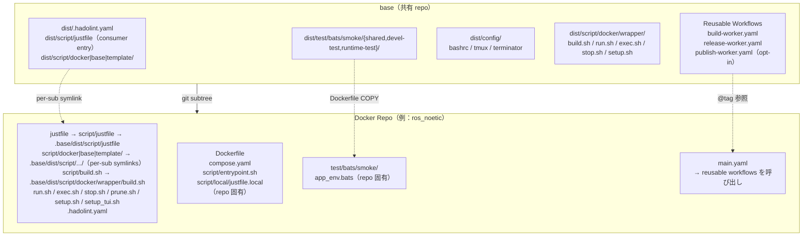
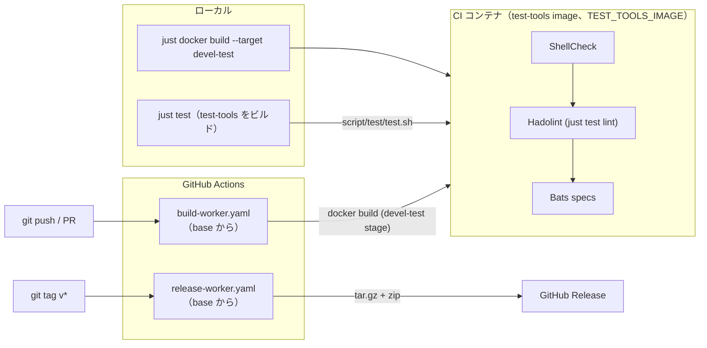

<!-- sync: base 1a496212d858 ae23e4414ff9 -->
# base

[](https://github.com/ycpss91255-docker/base/actions/workflows/self-test.yaml)


[](../../LICENSE)

[ycpss91255-docker](https://github.com/ycpss91255-docker) 組織のすべての Docker コンテナ repo で共有されるテンプレートです。

**[English](../../README.md)** | **[繁體中文](README.zh-TW.md)** | **[简体中文](README.zh-CN.md)** | **[日本語](README.ja.md)**

---

<!-- sync: table-of-contents 9cc5123f8582 0aa4ab9fc803 -->
## 目次

- [TL;DR](#tldr)
- [前提条件](#前提条件)
- [概要](#概要)
- [日常の使い方](#日常の使い方)
- [repo ごとのランタイム設定](#repo-ごとのランタイム設定)
- [アップグレード](#アップグレード)
- [CI Reusable Workflows](#ci-reusable-workflows)
- [開発とテスト](#開発とテスト)
- [ディレクトリ構造](#ディレクトリ構造)

---

<!-- sync: tldr e3106fd287a0 0bc47ad031cb -->
## TL;DR

```bash
# ゼロからの新規 repo：初回コミット + subtree + 初回ブートストラップ
mkdir <repo_name> && cd <repo_name>
git init
git commit --allow-empty -m "chore: initial commit"
git subtree add --prefix=.base \
    https://github.com/ycpss91255-docker/base.git vX.Y.Z --squash
./.base/dist/script/base/init.sh   # 初回ブートストラップ。以降は just base init

# アップグレード
just base update    # 新しい tag があるか確認
just base upgrade   # subtree pull + resync + workflow ref（「アップグレード」参照）

# 使う
just docker build   # イメージをビルド（必要なら先に setup.sh を実行）
just docker run     # devel コンテナを起動
just                # 全 namespace を表示
```

`git subtree add` には `HEAD` が必要です。`git init` 直後でコミットが 1 つも
ない repo では `ambiguous argument 'HEAD'` と `working tree has
modifications` で失敗します。空コミットで `HEAD` を作ると subtree が
merge できるようになります。

<!-- sync: prerequisites 4fa4246972db ad2674303f65 -->
## 前提条件

コンテナ操作は Docker 上で [`just`](https://github.com/casey/just)（command
runner）を介して実行します。`just <verb>` エントリポイントを使う前に、host へ
両方をインストールしてください:

- **Docker** + Docker Compose v2（`docker compose`）。
- **just** -- 本 repo はバージョンを 1 つに固定しています。test-tools
  イメージ、CI、`--bootstrap-just` インストーラはすべてその版を使うため、同じ
  recipe が 3 箇所で同じ挙動になります。版は
  `./.base/dist/script/base/just-version.sh` で表示できます（本 repo 内では
  `./dist/script/base/just-version.sh`）。版を指定できる公式のビルド済み
  バイナリインストーラでその版を導入してください:

  ```bash
  pin="$(./.base/dist/script/base/just-version.sh)"
  curl --proto '=https' --tlsv1.2 -sSf https://just.systems/install.sh \
      | bash -s -- --to ~/.local/bin --tag "${pin}"
  ```

  host のパッケージマネージャ（`apt install just`、`brew install just`、
  `cargo install just`）は**等価な選択肢ではなくフォールバック**です:
  それぞれの registry が持つ版が入るため、固定版より何マイナーも古い場合が
  あります。全方式は[公式インストールガイド](https://github.com/casey/just#installation)を
  参照。`just` が使えない場合、各 recipe には raw fallback
  （`./script/<verb>.sh`、`./.base/dist/script/base/upgrade.sh`）があります
  -- [アップグレード](#アップグレード)参照。

<!-- sync: overview f0da6f1fe447 9e6eb494da5c -->
## 概要

本 repo は、すべての Docker コンテナ repo で共有されるスクリプト、テスト、CI workflow を一元管理しています。15 以上の repo で同一ファイルを個別管理する代わりに、各 repo が **git subtree** としてこのテンプレートを取り込み、symlink で参照します。図による解説は [doc/arch/overview.html](../arch/overview.html) にあります。

<!-- sync: architecture 82511f59b040 0164c49b1c91 -->
### アーキテクチャ



<!-- sync: cicd-flow 45154f7b127c bc8e51394573 -->
### CI/CD フロー



<!-- sync: whats-included a0d828952feb d90ae256767e -->
### 含まれるもの

| ファイル | 説明 |
|----------|------|
| `script/build.sh` | コンテナをビルド（`--setup` は TTY があれば `setup_tui.sh`、なければ `setup.sh` を呼ぶ） |
| `script/run.sh` | コンテナを起動（X11/Wayland 対応。`--setup` の意味は `build.sh` と同じ。`--build` で先に `./script/build.sh test` を実行し fresh-clone の CI と同等の検証） |
| `script/exec.sh` | 実行中のコンテナに入る |
| `script/stop.sh` | コンテナを停止・削除 |
| `script/prune.sh` | この repo の dangling image / build cache を削除 |
| `script/setup_tui.sh` | 対話式 setup.toml エディタ（dialog / whiptail フロントエンド） |
| `dist/script/docker/wrapper/setup.sh` | システムパラメータを自動検出し `.env` / `.env.generated` + `compose.yaml` を生成 |
| `dist/script/docker/lib/_lib.sh` | 共通 wrapper ライブラリ（`_load_env`、`_compose`、`_compose_project` など） |
| `dist/script/docker/lib/bootstrap.sh` | wrapper 共通の初期化と引数解析 |
| `dist/script/docker/lib/compose.sh` | `docker compose` 呼び出しラッパー + project 命名 |
| `dist/script/docker/lib/compose_emit.sh` | `compose.yaml` のレンダラ |
| `dist/script/docker/lib/conf.sh` | setup.toml の読み書き（TOML。移行用に旧 INI も読む） |
| `dist/script/docker/lib/toml_bridge.sh` | TOML パーサのブリッジ（ネイティブまたはコンテナ） |
| `dist/script/docker/lib/config_gen.sh` | Go 設定ジェネレータのシェル側（[ADR-00000039](../adr/00000039-config-generator-in-go.md)） |
| `dist/script/docker/lib/conf_logging.sh` | logging 設定ヘルパー |
| `dist/script/docker/lib/env.sh` | 環境変数の設定と既定値 |
| `dist/script/docker/lib/gitignore.sh` | gitignore ファイル管理 |
| `dist/script/docker/lib/hook.sh` | wrapper ごとの pre/post hook 呼び出し |
| `dist/script/docker/lib/i18n.sh` | 言語検出とローカライズ（`_detect_lang`、`_LANG`） |
| `dist/script/docker/lib/log.sh` | 統一 logging と出力ユーティリティ |
| `dist/script/docker/lib/config_summary.sh` | ランタイム設定のサマリ |
| `dist/script/docker/lib/_tui_backend.sh` | `setup_tui.sh` が使う dialog / whiptail ラッパー関数 |
| `dist/script/docker/lib/_tui_conf.sh` | setup.toml の値の validator（`setup_tui.sh` と `setup.sh` で共有） |
| `dist/script/docker/runtime/logging.sh` | host 側 log tee ヘルパー（起動ごとのファイル + 固定 symlink） |
| `dist/script/docker/runtime/logrotate.sh` | 共通の rotate/symlink/prune プリミティブ（tee + transcript） |
| `dist/script/docker/runtime/watchdog.sh` | 汎用の単一サービス watchdog（再起動 + 差し替え可能なヘルスチェック） |
| `dist/script/docker/runtime/entrypoint.sh` | base の ENTRYPOINT オーケストレータ：log tee を開き、repo の bringup を source し、watchdog を起動し、workload を exec |
| `dist/dockerfile/entrypoint.sh` | bringup テンプレート。新規 repo では `script/entrypoint.sh` として seed される（repo 側の半分、オーケストレータが source） |
| `dist/test/bats/smoke/smoke.sh` | ランタイム install-check smoke（ldd による依存欠落スキャン） |
| `script/test/test.sh` | base 自身のテスト dispatcher（ローカル + コンテナ内） |
| `script/test/drivers/` | lint/test ツールごとに 1 つの driver |
| `script/test/lint_bare_stderr.sh` | Bare stderr lint チェッカー |
| `config/` | コンテナ内部の shell 設定（bashrc、tmux、terminator） |
| `setup.toml` | repo ごとの単一ランタイム設定（image / build / deploy / gui / network / volumes） |
| `dist/test/bats/smoke/` | 共有 smoke テスト + ランタイム assertion ヘルパー（[dockerfile-stages.md](../guide/dockerfile-stages.md#smoke-test-helpers-for-downstream-repos)） |
| `test/bats/unit/` | base 自身のテスト、Unit レベル（bats + kcov） |
| `test/bats/integration/` | base 自身のテスト、Integration レベル（init/upgrade のエンドツーエンド） |
| `test/bats/system/` | base 自身のテスト、System レベル / Regression（runtime smoke gate、opt-in） |
| `test/bats/acceptance/` | base 自身のテスト、Acceptance レベル（UAT/OAT。予約、S5 #785） |
| `.hadolint.yaml` | 共有 Hadolint ルール |
| `justfile`（→ `script/justfile`） | repo のエントリ — 階層化された namespace recipe（`just docker build`、`just docker run`、`just test`、`just base upgrade` など）。サブコマンドとフラグはそのまま転送されます（`"$@"`）。例：`just docker build --no-cache --target devel`。引数なしの `just` は全 namespace を表示。 |
| `dist/script/docker/justfile.docker` | `docker` namespace — コンテナ操作（`just docker build/run/start/exec/stop/prune/setup/setup-tui`）。 |
| `dist/script/base/justfile.base` | `base` namespace — `.base` subtree の管理（`just base init/update/upgrade/completions`）。 |
| `dist/script/base/init.sh` | 初回の symlink 設定 + 新規 repo の骨組み生成（bootstrap：`./.base/dist/script/base/init.sh`、以降は `just base init`）。 |
| `dist/script/base/upgrade.sh` | Subtree バージョンアップグレード（`just base upgrade [vX.Y.Z]`）。 |
| `script/test/justfile.test` | base 自身のテストエントリ（`just test`、`just test lint`、`just test coverage` …）。 |
| `script/release/justfile.release` | base の `release` namespace（release / publish ツール）。 |
| `script/watch/justfile.watch` | base の `watch` namespace — 上流リリースの監視（`just watch`、`just watch pins`、`just watch bump <name> <version>`）。 |
| `dist/dockerfile/Dockerfile` | 新規 repo 向けマルチステージ Dockerfile テンプレート |
| `dockerfile/Dockerfile.test-tools` | ビルド済み lint/test ツールイメージ（shellcheck、hadolint、bats、kcov） |
| `dockerfile/Dockerfile.config-gen` | Go 設定ジェネレータ（`config-gen`）をビルド。provisioning のみで、`compose.yaml` は引き続き `compose_emit.sh` が生成 |
| `dockerfile/config-gen/go.mod` | Go 設定ジェネレータのモジュール（[ADR-00000039](../adr/00000039-config-generator-in-go.md)） |
| `.github/workflows/` | reusable worker + base 自身の CI |

テストは **tool-first** で配置します — spec は `test/<tool>/<category>/`
（例：`test/bats/unit/`）、linter は `test/lint/<tool>/` — そのため
ツールの追加は新しいフォルダの追加であり、新しいコマンド面の追加では
ありません。分類語彙は ISTQB 準拠（Unit / Integration / System /
Acceptance の 4 レベル + Smoke タイプ）です。
[ADR-00000018](../adr/00000018-istqb-test-taxonomy.md) と
[ADR-00000012](../adr/00000012-tool-first-test-layout.md)
（category-first の ADR-00000004 を置き換え）参照。consumer は自身の
`test/bats/smoke/` を出荷し、base は自身の
`test/bats/{unit,integration,system,acceptance}/` を出荷します。

<!-- sync: what-stays-in-each-repo-not-shared dc4a422e6bf1 4a287a8050d5 -->
### 各 repo で個別管理するファイル（共有しない）

- `Dockerfile`
- `compose.yaml`
- `script/` — repo ローカルの **runtime helper**（コンテナ内で `ENTRYPOINT` / `CMD` から、または手動で呼ばれる）
  - `script/entrypoint.sh` — この repo の **bringup**。base のオーケストレータが source するもので、`ENTRYPOINT` そのものではありません（[entrypoint.md](../guide/entrypoint.md) 参照）
  - ros / app の起動ヘルパーなど
- `script/docker/` — repo ローカルの **Dockerfile 内部ビルドヘルパー**（Dockerfile の `RUN` から呼ばれ、起動中のコンテナでは使わない。スタブと lint COPY は `dist/dockerfile/Dockerfile` 参照、#275）
- `doc/` と `README.md`
- repo 固有の smoke テスト

<!-- sync: everyday-use 2010a1303130 20b6bdffcb3e -->
## 日常の使い方

「namespace と recipe のヘルプ」と「Wrapper UX チートシート（#291）」は英語版
のみです。[README.md](../../README.md#everyday-use) を参照してください。

<!-- sync: per-repo-runtime-configuration 4f345e108457 ab1539763dce -->
## repo ごとのランタイム設定

各下流 repo は 1 つの `setup.toml` で自身のランタイム設定
（GPU 予約 / GUI env/volumes / network mode / 追加 volume mounts）を
駆動します。`setup.sh` がこれ + システム検出結果を読み、`.env` /
`.env.generated` / `compose.yaml` を再生成します — これらの生成物をユーザ
が手動編集する必要はありません。別のファイルは `.env.local` で、setup は
最初に scaffold するだけで以後上書きせず、あなた自身の値はそこに置きます。

ファイルは 3 つのグループに分かれます：

- **`setup.sh apply` のたびに再生成**：`compose.yaml`、`.env.generated`、
  `.env`。手で編集しないでください。
- **repo のもの、上書きされない**：`setup.toml` と `Dockerfile`。ツールが
  `setup.toml` を書くのは頼まれたとき（`just docker setup set`、TUI）だけ
  です。アップグレード時の名前付きマイグレーションは
  [upgrade.sh が repo 内で書き換えるもの](#upgradesh-が-repo-内で書き換えるもの)
  に一覧があります。
- **ローカル**、gitignored、あなたのもの：`setup.local.toml` と `.env.local`。

`.env.generated` がサフィックスを保つ理由は別で、compose の `${VAR}` 補間の
ためだけに存在しコンテナには入りません — サフィックスは所有者ではなく分類を
表します。

初回の `setup.sh` 実行時（repo ごとの `setup.toml` がまだない場合）、
テンプレートが `<repo>/setup.toml` にコピーされ、検出した workspace が
**最初の `[[volumes]]` block** —— `volumes.mount_1` が指す block —— に
書き込まれます。以降の実行は `mount_1` を正とし、空にすれば workspace の
マウントをやめられます。`./.base/dist/script/base/init.sh --gen-conf` も同じ
単純コピーを行い、ファイルが既にあれば拒否します（`--force` は
`setup.toml.bak` にバックアップ）。

<!-- sync: one-conf-15-sections a6f1ae3719e2 17daf2a16728 -->
### 単一 conf、15 個の section

以下の section 一覧は散文ではなく `SCHEMA_SECTIONS`
（`dist/script/docker/lib/schema.sh`）— 「どの section が、どの順で存在
するか」の唯一の情報源です。このブロックまたはその個数がコードとずれると
`derived-figures` lint が失敗します。

```
[project]  name — この checkout が動く compose project（空 =
           <DOCKER_HUB_USER>-<IMAGE_NAME> を導出）。2 つの checkout を
           同時に動かすなら setup.local.toml に WORKTREE ごとに設定する
[image]    rules = prefix:docker_, suffix:_ws, @basename
[build]    apt_mirror_ubuntu、apt_mirror_debian            # Dockerfile build args
[deploy]   gpu_mode (auto|force|off)、gpu_count、gpu_capabilities
           dri_groups (auto|off) — GUI service への iGPU /dev/dri group_add
[lifecycle] restart (no|always|unless-stopped|on-failure|on-failure:N)
           既定は unless-stopped;DEPLOY スコープ — doc/guide/lifecycle.md
           参照。init (true|false) — Docker init/PID1 reaper;既定 true。
           watchdog_* — コンテナ内ヘルスチェック（opt-in）
[gui]      mode (auto|force|off)
[network]  mode (host|bridge|none)、ipc、pid (host|private)、privileged
           port_N = host:container（bridge のときのみ publish）
[security] privileged（false）、cap_add_N、cap_drop_N、security_opt_N
           （対応する *_inherit トグルも;既定は最小、必要な分だけ opt-in）
[resources] shm_size
[environment] env_N = KEY=VALUE — set-once の既定値。生成される .env に
           書き出され deployable stage の ENV としても bake される;
           タスクごとに変わる変数は .env.local へ
[tmpfs]    tmpfs_N = /path[:size=N] — RAM-backed マウントポイント
[devices]  device_N = host:container、および cgroup rule（opt-in）
[volumes]  mount_1（workspace、初回実行時に自動記入）
           mount_2..mount_N（追加の host mount；デバイスは /dev path 指定）
[additional_contexts] context_N = name=source — 追加の名前付き build context
[logging]  driver（デフォルト json-file）、max_size、max_file、compress
           local_path（host 側 log ディレクトリ；/var/log/<repo> にバインドマウント）
           container_log_keep (20)、container_log_days (14)（起動ごとの
           コンテナ log 保持；keep-count と age の厳しい方が勝つ）
           wrapper_transcript（verb の出力を log/<verb>/ に tee；既定 true）、
           wrapper_transcript_keep (20)、wrapper_transcript_days (14)
           [logging.<svc>] で個別 service に key-level override 可能
```

上の角括弧の名前は section の一覧であって、ファイルの構文ではありません。
スカラー section は TOML の `[table]`、リスト形式の section は
`[[array of tables]]` で、その N 番目の block が `<prefix>_N` が指すもの
です —— `volumes.mount_1` は最初の `[[volumes]]` block です。

テンプレート既定値は `.base/dist/setup.toml`；repo ごとの上書きは
`<repo>/setup.toml`（`just docker setup` が管理し、手で編集する `config/` 面には
意図的に置かない）。マージは**型を見る**方式です
（[ADR-00000037](../adr/00000037-toml-config-format-unification.md)）：
`[table]` 内のスカラーキーは key-level マージ —— そのキーを定義する最上位
レイヤが勝ち、そのレイヤが触れないキーは下位から継承します —— 一方
`[[array of tables]]` は、それを定義する最上位レイヤが配列ごと置き換え
ます。どのレイヤも触れない section は下位に落ちます。

<!-- sync: three-layers-the-third-is-yours-setuplocaltoml 0140754d2189 1cf0d735b9fc -->
#### 3 レイヤ、3 枚目はあなたのもの（`setup.local.toml`）

| レイヤ | バージョン管理 | 誰のものか |
|---|---|---|
| `.base/dist/setup.toml` | subtree で出荷 | base の既定値 |
| `<repo>/setup.toml` | commit 済み | repo のもの —— CI も他のどの checkout もこれを使う |
| `<repo>/setup.local.toml` | **gitignored** | あなたのもの。このマシン、この worktree だけ |

文法もマージ規則も全レイヤ共通です。3 枚目は `--local` で書きます：

```bash
just docker setup set --local project.name myrepo-wt2
```

リストは要素ごとにマージせず丸ごと置き換えます。順序付きリストを半分だけ
上書きすると要素を削除できず、どのレイヤも書いていない組み合わせができる
ためです。そこから次の 3 つが従い、いずれも黙って起きることはありません：

- `setup.local.toml` が定義している section を通常の `set` で書くと、
  section 名を挙げて**警告**します。拒否はしません —— その値は CI や他の
  checkout が使う commit 済みの値です —— が、このマシンでは何も変わりません。
- すべての wrapper の実行前サマリに `local override:` 行が付き、ファイルと
  それが置き換える section を示します。
- `just docker setup deploy` はこのファイルがある間**拒否**します
  （[field-deploy.md](../guide/field-deploy.md) 参照）。

<!-- sync: topic-guides 8ef0959e6ba4 fcb22012ad23 -->
### トピックガイド

深いトピックはそれぞれ `doc/guide/` の 1 ページにあります（英語のみ。英語
README が正）：

- [Dockerfile stages](../guide/dockerfile-stages.md) -- stage 表、`/opt` に
  bake する成果物、追加 stage、`[stage:<name>]` の上書き、smoke テストヘルパー。
- [Container entrypoint](../guide/entrypoint.md) -- base のオーケストレータ、
  あなたの bringup、一度きりの `ENTRYPOINT` 移行。
- [Container lifecycle](../guide/lifecycle.md) -- 2 つの worktree の同時実行、
  network mode、restart policy、init、watchdog。
- [パラメータの置き場所](../guide/env-vs-workload.md) -- `setup.toml`、
  `.env.local`、`config/<component>/` の役割分担。
- [フィールド配備](../guide/field-deploy.md) -- `just docker setup deploy` と
  自己完結 bundle。
- [Logging](../guide/logging.md) -- コンテナ log の host 出力と wrapper transcript。
- [setup.sh のワークフロー](../guide/setup-workflow.md) -- TUI、host 検出の上書き、
  wrapper ごとの hook。
- [命名スキーム](../guide/naming.md) -- image、project、container の名前と、
  唯一の `container_name` の例外。
- [publish-worker.yaml と source archive](../guide/publish-worker.md)。

開発 stack は `container_name:` を emit せず、唯一の例外であるフィールド配備 bundle（`just docker setup deploy`）だけが `container_name:` を焼き込みます —— [naming.md](../guide/naming.md) 参照。

<!-- sync: when-setupsh-runs c467aa1f8353 2f37b0271487 -->
### setup.sh の実行タイミング

`setup.sh` は build / run の度に再実行されることはありませんが、名前を
指定して頼んだ時だけ走るわけでもありません — 次がトリガーです：

- **`just base init` / `./.base/dist/script/base/init.sh`** がスケルトン生成後に 1 回自動実行
- **`just base upgrade` / `./.base/dist/script/base/upgrade.sh`** が subtree pull の後に
  init.sh 経由でもう一度実行されるため、アップグレードは常に新しい
  baseline で `.env` / `.env.generated` / `compose.yaml` を再生成した
  状態で着地します
- **`just docker build --setup` / `just docker run --setup`**（または `-s`）— 明示的に再実行
- **初回 bootstrap**：`just docker build` / `just docker run` は
  `.env.generated` が無い初回実行（CI の新規 clone 等）で setup.sh を自動実行
  します。`--setup` 指定は不要
- **Drift**：build と run は毎回まず `setup.sh check-drift` を実行します —
  [ドリフト検出](#ドリフト検出)参照

> **Fresh-clone の lint カバレッジ（#216）**：image がローカルに
> キャッシュされていない `just docker run` は Compose auto-build を起動
> しますが、auto-build は **`target: devel`**（または `-t` で指定
> された target）のみをビルドし、`target: devel-test` レイヤの
> ShellCheck / Hadolint / Bats smoke はスキップされます。`run.sh` は
> この状況を検知すると `[run] INFO:` ブロックを表示します（TTY 環境のみ）。
> CI と同じ完全な検証を 1 コマンドで実行したい場合は `--build` フラグを
> 付けてください：
>
> ```bash
> just docker build test                   # 明示的に lint + smoke を実行
> just docker run --build                  # lint + smoke を実行してから compose up
> just docker run                          # デフォルト — 高速パス、lint/smoke はスキップ
> ```

`setup.sh apply` は毎回 `compose.yaml` をゼロから書き直しますが、
既存 `.env.generated` の `WS_PATH` / `APT_MIRROR_UBUNTU` /
`APT_MIRROR_DEBIAN` は保持されるため、手動で調整した workspace パスや
apt mirror はアップグレードで上書きされません。

<!-- sync: drift-detection 2ebe5e1725e2 26df6733cedc -->
### ドリフト検出

`setup.sh apply` は `.env.generated` に 5 つの値を記録します：
`SETUP_CONF_HASH` / `SETUP_DOCKERFILE_HASH` / `SETUP_GUI_DETECTED` /
`GPU_ENABLED` / `USER_UID`。`just docker build` / `just docker run` は毎回
これらを現在の tree と host と比較し、前回の setup から変化したものごとに
`[WARNING]` を出力します（実行は継続）：

- `setup.toml` の内容（`SETUP_CONF_HASH`）
- Dockerfile の stage 一覧（`SETUP_DOCKERFILE_HASH`）— `FROM ... AS <stage>`
  の追加・削除
- GPU 検出結果（`GPU_ENABLED`）
- GUI 検出結果（`SETUP_GUI_DETECTED`）
- `USER_UID`（ユーザ ID の変化）

手動で再実行する必要はありません：wrapper が `setup.sh check-drift` を実行し、
drift が報告されたら `.env` / `.env.generated` / `compose.yaml` を自動で
再生成します — いずれも派生物でありユーザのデータを持たないため、drift 時の
再生成は常に安全です。`--setup` はその場で再生成を強制し、TTY では
`setup_tui.sh` を先に開きます。

<!-- sync: setupsh-subcommands f2810d447771 91bb36cd4566 -->
### setup.sh のサブコマンド

`setup.sh` は git 風のバックエンドで、明示的なサブコマンドを持ち、
`just docker setup <サブコマンド>` で呼べます。build / run / TUI スクリプトが
代わりに呼ぶので、直接呼ぶのはスクリプト化や非対話の用途です：

| サブコマンド | 用途 |
|---|---|
| `apply` | setup.toml + システム検出から `.env` + `.env.generated` + `compose.yaml` を再生成（`.env.local` には触れない） |
| `check-drift` | 同期なら 0、drift なら 1（drift の説明は stderr） |
| `set <section>.<key> <value>` | 単一キーを書く。`--local` で commit 済みの `setup.toml` ではなく gitignored の `setup.local.toml` に書く。付けない場合、`setup.local.toml` が定義済みの section を書くと名前付きで警告 |
| `show <section>[.<key>]` | 単一キーまたは section 全体を読む |
| `list [<section>]` | key = value 形式のダンプ |
| `add <section>.<list> <value>` | リスト型 section（`mount_*` / `env_*` / `port_*` …）に追加。空きスロットを優先、なければ `max+1`。`--local` 可 |
| `remove <section>.<key>` / `<section>.<list> <value>` | キーまたは値の一致で削除。`--local` 可 |
| `reset [-y\|--yes]` | テンプレート既定に戻す。旧 `setup.toml` → `setup.toml.bak`、旧 `.env.generated` → `.env.bak`。`.env.local` には触れない |
| `deploy [--stage S] [-y] [--dry-run] [--allow-local-override]` | フィールド配備 bundle をビルド。[field-deploy.md](../guide/field-deploy.md) 参照 |

型付きキーは `_tui_conf.sh` の validator（TUI と同じもの）で検証されます。
`set` / `add` / `remove` / `reset` は `.env.generated` を再生成**しません** —
続けて `apply` するか、次の build / run が drift で再生成します。引数なしの
`setup.sh` はヘルプを表示します：v0.11.0 で暗黙の `apply` を廃止した経緯は
[doc/deprecations.md](../deprecations.md) にあります。

<!-- sync: derived-artifacts-gitignored a3a31b52be28 1e630a8f6e59 -->
### 生成物（gitignored）

- `.env.generated` — compose 補間用の変数（解決済みの `PROJECT_NAME` を
  含む）+ `SETUP_*` drift metadata;コンテナには入りません
- `.env` — コンテナに入る既定値：`[environment]` の一覧と
  `[lifecycle] watchdog_*` ブロックを、埋まった一覧として書き出したもの
- `compose.yaml` — baseline + 条件ブロック込みの完全な compose

いつでも `compose.yaml` を開けば現在の完全なランタイム設定を確認できます。
3 ファイルとも `just base upgrade` のたびに再生成されます（init.sh が subtree
pull 後に `setup.sh apply` を再実行）— 手動編集はしないでください。
override は `setup.toml` に書きます。

`.env.local` も gitignore されますが生成物では**ありません**。あなたのもので、
最初の apply で一度 scaffold されたあとは上書きされません。編集しても setup の
実行で消えることはありません。compose は `.env` の後にこれを読み込むので、
両方にあるキーはあなたの値が使われます。

> **v0.43.0 より前からのアップグレード**：`.env` は以前は手書きファイルでした。
> `just base upgrade` は何かが再生成する前に、手書きの `.env` を `.env.local`
> へリネームします。そのアップグレード経路を飛ばして先に `setup` を実行した
> 場合、値が `.env.bak` に残るのはそのファイルが旧い補間キャッシュだったとき
> だけです。それ以外は自分のバックアップから復元してください。

`setup.local.toml` は 1 つ上のレイヤで同じ形をしています：gitignored、
あなたのもの、ツールが書き換えることはありません。設定の*入力*であって
生成物ではありません ——
[3 レイヤ](#3-レイヤ3-枚目はあなたのものsetuplocaltoml)参照。

<!-- sync: upgrading 56de8c94ebd2 629908638ad8 -->
## アップグレード

<!-- sync: updating 0c4663a7ac2e b705ceacd9a9 -->
### 更新

前提条件：`git config user.name` / `user.email` が設定済みで、working tree
が merge / rebase / cherry-pick / revert 進行中ではないこと — upgrade.sh
は対処方針付きのメッセージを出して fail-fast し、中途半端な pull を防ぎます。

```bash
# 新バージョンの確認
just base update

# 最新にアップグレード（subtree pull + バージョンファイル + workflow tag）
just base upgrade

# バージョン指定
just base upgrade v0.3.0
# 指定したバージョンが現在の local pin より古い場合（例：v0.12.0-rc1 から
# v0.11.0 への巻き戻し）は SemVer §11 に従って暗黙の downgrade として
# 拒否されます。意図的な rollback の場合は .base/.version を手動編集
# してください。

# just が使えない場合のフォールバック
./.base/dist/script/base/upgrade.sh v0.3.0
```

`upgrade.sh` は一度に完結します。**ただし、あなたの repo に書き込みます。
書き換えの一部はあなた自身のファイルです** — 稼働中の field デプロイを持つ
repo で実行する前に
[upgrade.sh が repo 内で書き換えるもの](#upgradesh-が-repo-内で書き換えるもの)
を読んでください。手順：

1. `git subtree pull --prefix=.base ... --squash`。commit メッセージは
   `chore: upgrade .base subtree to <version>`
2. Post-pull 整合性チェック — subtree マーカー（`.base/.version`、
   `.base/dist/script/base/init.sh`、`.base/dist/script/docker/wrapper/setup.sh`）が消えた場合は
   `git reset --hard` で rollback（旧 `git-subtree.sh` の destructive FF
   対策）
3. `./.base/dist/script/base/init.sh` 再実行：`script/*.sh` wrapper symlink と
   ルートの `justfile` の再同期、退役したルートのリンクの削除、またいだ
   バージョン範囲で選ばれる名前付きマイグレーションの実行、`.gitignore` を
   canonical entry set に同期、derived artifact になった旧 tracked ファイル
   （`.env.generated`、`compose.yaml`、…）を `git rm --cached`、最後に
   `setup.sh apply` を呼んで `.env.generated` + `compose.yaml` を再生成
4. `sed` で `.github/workflows/main.yaml` 内のすべての
   `ycpss91255-docker/base/.github/workflows/<file>@vX.Y.Z` ref を更新し、
   手順 3 の変更と合わせて `chore: update template references to <version>`
   として commit
5. `apply_migrations`（`lib/dockerfile_migrate.sh`）が、base contract の
   変更に追随できていない **repo ルートの `Dockerfile`** と
   **`script/entrypoint.sh`** を修復し、手順 3-4 と同じ commit に含めます

手動で `git subtree pull` しないでください — 整合性チェック、init.sh
resync、sed、マイグレーションの手順は忘れがちです。

**pull の後のどれか一手順でも失敗したら、アップグレード全体が巻き戻され
ます。** pull は手順 2-5 より先に commit するため、そこで中断すると以前
は「バージョンだけ上がって resync は一度も走っていない」リポジトリが残り
ました — 壊れた wrapper 一式と、きれいな `git status` です。今は実行開始
時の commit まで reset し、自分が作ったファイルも取り除くので、失敗した
アップグレードが残すのは「何も変わっていない状態とエラー」だけです。手元
の未 commit の作業が危険にさらされることはありません。`git subtree` は
そもそも dirty tree では起動を拒否するため、pull 後に存在する変更はすべ
てそのアップグレード自身が作ったものです。

> **`v0.41.0` 以前から、ファイルが移動した後のツリーへ上げる場合。**
> アップグレードを駆動するのは自分の `.base/` に vendor されたスクリプト
> なので、実際に走るのは旧リリースの版です。`v0.41.0` までのリリースは
> `./.base/init.sh` を呼びますが、`dist/` 再編でその位置から移動しました。
> 旧パスに置いた互換フォワーダがそれらを動き続けさせます。すでにこの失敗
> を踏んでいる場合（`.base/.version` は上がっているのに `just --list` が
> justfile を見つけられない）、壊れているものは何もありません — resync
> が走らなかっただけです。手動で走らせて commit してください:
>
> ```bash
> ./.base/dist/script/base/init.sh
> git add -A && git commit -m "chore: resync .base wrappers"
> ```

<!-- sync: pointing-base-at-a-different-upstream 9621cc89b4d5 f0c7c0507b2f -->
#### `.base` を別の upstream に向ける

`TEMPLATE_REMOTE` は `.base` に関わるすべての操作が読む git remote です
（新しいタグの有無を問い合わせるクエリと、working tree の `.base/` を
書き換える `git subtree pull`）。既定は
`https://github.com/ycpss91255-docker/base.git` — HTTPS なので、clone
した直後の環境、CI runner、SSH 鍵を持たない初めての貢献者でもそのまま
動きます。この既定値の定義は
`.base/dist/script/base/upstream.sh` の 1 か所だけで、
`TEMPLATE_REMOTE` は実行ごとの上書きです。

```bash
# HTTPS ではなく SSH（agent 認証、または SSH でしか到達できない fork）
TEMPLATE_REMOTE=git@github.com:ycpss91255-docker/base.git just base upgrade

# 自分で保守する private fork: この repo が追うのは「あなたの」base
TEMPLATE_REMOTE=git@github.com:acme/base.git just base upgrade v1.2.0
```

**`.base/dist/` 配下はすべてこの URL から取得され、そのまま実行されます**
— wrapper、lib、Dockerfile、entrypoint のすべてです。自分の repo と同じ
だけ信頼できる場所にのみ向けてください。その repo を管理する人が、次の
`just docker build` で動くものを決めることになります。conf キーではなく実行ごと
の環境変数である理由もそこにあります。向き先の変更は実行したコマンドに
残り、以後のアップグレードを黙って書き換えるファイルには残りません。長期
的な fork は shell profile の export ではなく、自分のツールチェーンに明示
的に組み込んでください。

毎週のアップグレード「通知」（`check-base-version.sh`）は別の変数
`BASE_REPO` を読みます。[CONTEXT.md](../../CONTEXT.md) の base version
monitor を参照してください。

<!-- sync: what-upgradesh-rewrites-in-your-repo a9b5fd89f4c4 79ef7c510eaf -->
#### upgrade.sh が repo 内で書き換えるもの

`.base/` は base のもの、それ以外は全部あなたのものです。それでも
アップグレードは `.base/` の外に対して読み取り専用では**ありません**：
subtree の内側で吸収できない base contract の変更は、あなたのファイル側で
修復されます。しかも upgrade.sh はそれを **commit** して行うため、変更は
あなたの名義で history に入ります。すべて stdout に出るので隠れてはいません
が、ログは流れていくので、完全な一覧を以下に示します。

| タイミング | 書き換わるもの | Commit メッセージ |
|---|---|---|
| 手順 1 | `.base/`（subtree pull） | `chore: upgrade .base subtree to <version>` |
| 手順 3 | 移設前の `config/docker/setup.conf` をルートの `.setup.conf` へ移動（両方ある場合はマージ、`lib/setup_conf_migrate.sh`） | 手順 4 の commit に同梱 |
| 手順 3 | 旧 INI 形式の `.setup.conf` を `setup.toml` に変換（`lib/ini_to_toml_migrate.sh`） | 手順 4 の commit に同梱 |
| 手順 3 | 手書きの `.env` を `.env.local` にリネーム | 手順 4 の commit に同梱 |
| 手順 3 | `setup.toml` の `[lifecycle] restart = "no"` → `"unless-stopped"`。またいだバージョン範囲で選択（`lib/version_migrate.sh`） | 手順 4 の commit に同梱 |
| 手順 3 | `.gitignore` の canonical entry；derived になったファイルの `git rm --cached` | 手順 4 の commit に同梱 |
| 手順 4 | `.github/workflows/main.yaml` の worker `@vX.Y.Z` ref | `chore: update template references to <version>` |
| 手順 5 | repo ルートの `Dockerfile`、`script/entrypoint.sh`（`apply_migrations`） | 手順 4 の commit に同梱 |

> **restart のマイグレーションは runtime の挙動を変えます。**
> `[lifecycle] restart` は以前 devel スコープで、template の既定値が `no`
> でした。`init.sh --gen-conf` は template を丸ごとコピーするため、ほぼ
> すべての repo が「誰も選んでいない」`restart = no` を抱えています。この
> key は現在 deploy スコープ（[lifecycle.md](../guide/lifecycle.md#restart-policy-is-deploy-scoped-841)
> 参照）なので、コピーされた `no` は構造的に古い値です。だから書き換え
> られます — **これまで host の再起動後に上がってこなかった deployable
> stage のコンテナが、以後は自動的に起動します。** 実行されるのはバージョン
> 範囲がこの rescope をまたぐ 1 回のアップグレードだけで、値がちょうど `no`
> のときだけです。他の値を選んだ repo には一切触れません。`no` が望みなら
> アップグレード後に戻してください。以後書き換えられることはありません。

**実際に何が変更されたかを後から確認するには：**

```bash
git log --oneline <アップグレード前の sha>..HEAD        # アップグレードの commit を名前で列挙
git diff <アップグレード前の sha>..HEAD -- . ':!.base'  # .base/ 以外のすべての差分
```

upgrade.sh が **触れない**もの：`setup.toml` のうち上記マイグレーション以外の
すべてと、`<repo>/config/`（bashrc / tmux / terminator …）全体です —
上流の `.base/dist/config/` や `.base/dist/setup.toml` が前回 pull 以降
変わっていれば、upgrade.sh は `diff -ruN .base/dist/config config` のヒントを
表示するだけで、あなたの代わりにマージはしません。

<!-- sync: automated-version-bumps-optional 885a5a03faa6 d7096eddf6af -->
#### 自動バージョン更新（任意）

新しい base tag が出るたびに Dependabot に PR を立てさせられます：
`github-actions` ecosystem と `directory: "/"` を指定した
`.github/dependabot.yml` を追加してください。更新されるのは `main.yaml` の
`uses: ycpss91255-docker/base/...@vX.Y.Z` ref だけで、subtree 自体は引き続き
ローカルで `just base upgrade vX.Y.Z` を実行します。

<!-- sync: ci-reusable-workflows 5b9ed4f4572c 98490d2c8ae4 -->
## CI Reusable Workflows

下流 repo は `.github/workflows/main.yaml` からこれらの reusable workflow を呼び出します：

```yaml
# .github/workflows/main.yaml
jobs:
  call-docker-build:
    uses: ycpss91255-docker/base/.github/workflows/build-worker.yaml@vX.Y.Z
    with:
      image_name: my_app
      build_args: |
        BASE_IMAGE=python:3.11-slim
        APP_VERSION=1.0
        DEBIAN_CODENAME=bookworm

  call-release:
    needs: call-docker-build
    if: startsWith(github.ref, 'refs/tags/')
    permissions:
      contents: write
    uses: ycpss91255-docker/base/.github/workflows/release-worker.yaml@vX.Y.Z
    with:
      archive_name_prefix: my_app
```

<!-- sync: build-workeryaml-common-inputs 22209d9818e6 2495d4e62bd2 -->
### build-worker.yaml の主なパラメータ

| パラメータ | 型 | 必須 | デフォルト | 説明 |
|------------|------|------|------------|------|
| `image_name` | string | はい | - | コンテナイメージ名 |
| `build_args` | string | いいえ | `""` | 複数行 KEY=VALUE ビルド引数 |
| `build_runtime` | boolean | いいえ | `true` | runtime ビルドのオプトアウト(`false`)。stage の有無は Dockerfile から読み取る: `runtime` / `runtime-test` を宣言していればビルドし、なければスキップするので、runtime stage を持たない repo はここを変更する必要がない |
| `platforms` | string | いいえ | `"linux/amd64"` | カンマ区切りのターゲットプラットフォーム；各プラットフォームがネイティブ runner 上で並列実行（`linux/amd64` → ubuntu-latest、`linux/arm64` → ubuntu-24.04-arm） |

全 11 個のパラメータは `.github/workflows/build-worker.yaml` の
`on.workflow_call.inputs` を参照
（[ADR-00000028](../adr/00000028-documentation-is-derived-not-duplicated.md)）。

`devel-test` / `runtime-test` stage が FROM するツールイメージは入力では
ない。worker が自身の ref で取得する base checkout の `.version` から導出
され、それは `release-test-tools.yaml` がそのイメージを公開するタグでも
ある —— つまり worker をピン留めした `@vX.Y.Z` がツールイメージもピン留め
する。以前は `test_tools_version` 入力が担っており、デフォルトはローリング
な `latest` だった。まだこの入力を渡している呼び出し側は、その行を削除する
必要がある。

<!-- sync: release-workeryaml-inputs 89f7de4f5d1a 1d1cefd1f85c -->
### release-worker.yaml パラメータ

| パラメータ | 型 | 必須 | デフォルト | 説明 |
|------------|------|------|------------|------|
| `archive_name_prefix` | string | はい | - | アーカイブ名プレフィックス |
| `extra_files` | string | いいえ | `""` | 追加ファイル（スペース区切り） |
| `version` | string | いいえ | `""` | リリースするバージョン（`vX.Y.Z`）。tag 経由の経路では未設定のままにすると、push された tag から読み取られる。tag 以外の run からこの worker を直接呼ぶ場合に渡す：既定の `GITHUB_TOKEN` で作成されたイベントは新しい workflow run を開始しないため、マージ済みの変更を自動リリースする repo は tag を push しても到達できない。`vX.Y.Z[-suffix]` でない値はリリースされず拒否される |

`publish-worker.yaml`（opt-in。他の repo が `FROM` する基盤イメージ repo 向け）
は tag push 時に Dockerfile の target stage を registry へ push します。入力、
複数バリアントの呼び出し例、base のリリースの source archive が下流のリリースと
どう違うかは [publish-worker.md](../guide/publish-worker.md) を参照。

<!-- sync: development-and-tests 750400f91f7b 03ee83a59fb0 -->
## 開発とテスト

base の checkout 内で（`script/test/justfile.test`）：

```bash
just test               # 全 linter + Bats（no kcov）、docker compose 経由
just test lint          # lint フェーズの全 linter
just test lint --shellcheck   # 1 つの linter に絞る（--hadolint、--readme-sync、...）
just test coverage      # Bats 全体を kcov 下で実行。lint フェーズなし
just test coverage-local      # 同じ kcov 実行をローカルの in-job モードで
just test go            # Go config-gen：build、lint、test、カバレッジ floor、mutation
just test system        # opt-in の System レベル（host docker が必要）
just test acceptance    # Acceptance レベル：実際に consumer を scaffold
just test smoke         # 出荷される smoke spec
just release coverage-badge   # coverage/ から doc/badge/coverage.svg を再生成
```

カバレッジバッジは Bats 全体が Bash ソースに対して計測した kcov の行カバレッジ
で、リリースごとに 1 回計測します。Go パッケージはパッケージごとの floor で
ゲートされます（`just test go`）。計測方法は
[ADR-00000008](../adr/00000008-coverage-sharded-pr-gate.md)、テスト索引は
[TEST.md](../test/TEST.md)（カテゴリ別一覧：[unit](../test/unit.md) /
[integration](../test/integration.md) / [system](../test/system.md) /
[acceptance](../test/acceptance.md) / [smoke](../test/smoke.md)）、全 recipe は
`script/test/justfile.test` を参照。

<!-- sync: directory-structure ab00213e0736 9fbc52a797a0 -->
## ディレクトリ構造

```
.base/                                  # consumer の <repo>/.base/ に固定される subtree
├── .version                            # 固定された base リリース tag
├── justfile                            # base 自身のエントリ（mods test / release / watch）
├── compose.yaml                        # base CI runner（test-tools サービス）
├── dist/                               # 出荷物：setup.toml、env.toml、.hadolint.yaml、
│                                       #   config/、dockerfile/、script/{docker,base,template}/、
│                                       #   deploy/（cd-guard + bundle README）、test/bats/smoke/
├── script/                             # base 自身のツール：test/、release/、watch/、ci/
├── dockerfile/                         # Dockerfile.test-tools / .config-gen / .smoke /
│                                       #   .toml-bridge、config-gen/ Go モジュール、kcov パッチ
├── test/                               # base 自身の spec：bats/{unit,integration,system,acceptance}/
├── .github/                            # reusable worker + base CI workflow、dependabot.yml
├── doc/
│   ├── badge/                          # 生成されるリリースカバレッジバッジ（リリース時に hand-run、bump 呼び出し元は未接続：docker_harness#289）
│   ├── guide/                          # README からリンクされるトピックガイド
│   ├── readme/                         # README の翻訳（zh-TW / zh-CN / ja）
│   ├── adr/                            # Architecture Decision Records
│   ├── arch/                           # アーキテクチャ図（自己完結 HTML）
│   ├── test/                           # テスト索引 + レベル別 spec 一覧
│   ├── changelog/                      # 生成される索引の下に 0.Y シリーズごと 1 ファイル
│   └── deprecations.md
├── CONTEXT.md
├── LICENSE
└── README.md
```


<!-- Sections of the English README.md that this abridged translation
     deliberately does not carry. Declared, not forgotten: the sync guard
     (just test sync-readme, and the lint inside just test) reports any
     English section that is neither translated nor listed below.
     Translate one and its entry becomes a sync marker above the new
     translated heading. -->
<!-- sync-skip: getting-help-namespace-vs-recipe -- untranslated: the localized READMEs are abridged; README.md is authoritative -->
<!-- sync-skip: wrapper-ux-cheat-sheet-291 -- untranslated: the localized READMEs are abridged; README.md is authoritative -->
