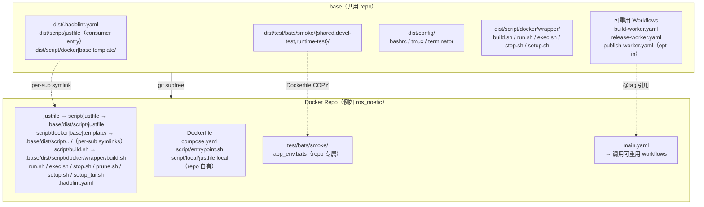
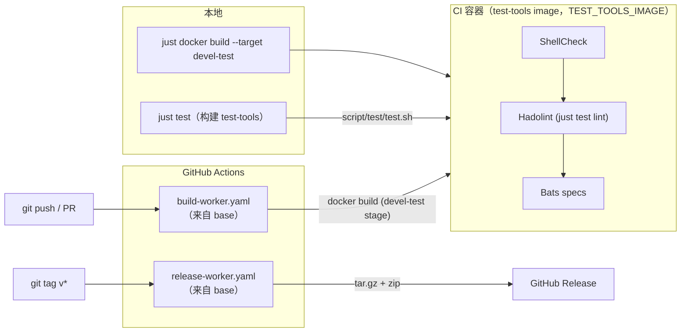

<!-- sync: base 1a496212d858 81de30627b69 -->
# base

[](https://github.com/ycpss91255-docker/base/actions/workflows/self-test.yaml)


[](../../LICENSE)

[ycpss91255-docker](https://github.com/ycpss91255-docker) 组织下所有 Docker 容器 repo 的共用模板。

**[English](../../README.md)** | **[繁體中文](README.zh-TW.md)** | **[简体中文](README.zh-CN.md)** | **[日本語](README.ja.md)**

---

<!-- sync: table-of-contents 9cc5123f8582 b1e289517dfe -->
## 目录

- [TL;DR](#tldr)
- [必要条件](#必要条件)
- [概述](#概述)
- [日常使用](#日常使用)
- [各 repo runtime 配置](#各-repo-runtime-配置)
- [升级](#升级)
- [CI Reusable Workflows](#ci-reusable-workflows)
- [开发与测试](#开发与测试)
- [目录结构](#目录结构)

---

<!-- sync: tldr e3106fd287a0 5a2258d43b26 -->
## TL;DR

```bash
# 从零开始的新 repo：首个 commit + subtree + 一次性 bootstrap
mkdir <repo_name> && cd <repo_name>
git init
git commit --allow-empty -m "chore: initial commit"
git subtree add --prefix=.base \
    https://github.com/ycpss91255-docker/base.git vX.Y.Z --squash
./.base/dist/script/base/init.sh   # 一次性 bootstrap；之后用 just base init

# 升级
just base update    # 有没有新 tag？
just base upgrade   # subtree pull + resync + workflow ref（见「升级」）

# 使用
just docker build   # 构建 image（需要时先跑 setup.sh）
just docker run     # 启动 devel 容器
just                # 列出所有 namespace
```

`git subtree add` 需要 `HEAD` 存在。在刚 `git init` 且没有任何 commit 的
repo 上会报错 `ambiguous argument 'HEAD'` 与 `working tree has
modifications`；空 commit 建立 `HEAD` 后，subtree 才能 merge 进来。

<!-- sync: prerequisites 4fa4246972db a8faa5a1ee42 -->
## 必要条件

容器操作透过 [`just`](https://github.com/casey/just)（command runner）搭配
Docker 运行。使用 `just <verb>` 入口前，请先在 host 安装两者：

- **Docker** + Docker Compose v2（`docker compose`）。
- **just** -- 本 repo 只钉住一个版本。test-tools image、CI 与
  `--bootstrap-just` 安装程序都使用该版本，因此同一个 recipe 在三处行为一致；
  用 `./.base/dist/script/base/just-version.sh` 打印版本（在本 repo 内为
  `./dist/script/base/just-version.sh`）。请用可指定版本的官方预编译 binary
  安装程序安装该版本：

  ```bash
  pin="$(./.base/dist/script/base/just-version.sh)"
  curl --proto '=https' --tlsv1.2 -sSf https://just.systems/install.sh \
      | bash -s -- --to ~/.local/bin --tag "${pin}"
  ```

  host 包管理器（`apt install just`、`brew install just`、
  `cargo install just`）是 **fallback 而非等价选项**：它安装的是各自 registry
  收录的版本，可能落后钉住的版本许多个 minor。完整方式见[官方安装指南](https://github.com/casey/just#installation)。若
  `just` 不可用，每个 recipe 都有 raw fallback（`./script/<verb>.sh`、
  `./.base/dist/script/base/upgrade.sh`）-- 见[升级](#升级)。

<!-- sync: overview f0da6f1fe447 928224bf160b -->
## 概述

此 repo 集中管理所有 Docker 容器 repo 共用的脚本、测试和 CI workflow。各 repo 透过 **git subtree** 拉入此模板，并使用 symlink 引用共用文件。图解导览见 [doc/arch/overview.html](../arch/overview.html)。

<!-- sync: architecture 82511f59b040 7fdb6c66be69 -->
### 架构



<!-- sync: cicd-flow 45154f7b127c cbab4f2ca3b1 -->
### CI/CD 流程



<!-- sync: whats-included a0d828952feb dfeb2e2023cd -->
### 包含内容

| 文件 | 说明 |
|------|------|
| `script/build.sh` | 构建容器（`--setup` 有 TTY 时启动 `setup_tui.sh`，否则调用 `setup.sh`） |
| `script/run.sh` | 运行容器（支持 X11/Wayland；`--setup` 语意与 `build.sh` 相同；`--build` 会先跑 `./script/build.sh test`，取得与 fresh-clone CI 相同的验证） |
| `script/exec.sh` | 进入运行中的容器 |
| `script/stop.sh` | 停止并移除容器 |
| `script/prune.sh` | 清理这个 repo 的悬空 image / build cache |
| `script/setup_tui.sh` | 互动式 setup.toml 编辑器（dialog / whiptail 前端） |
| `dist/script/docker/wrapper/setup.sh` | 自动检测系统参数并产生 `.env` / `.env.generated` + `compose.yaml` |
| `dist/script/docker/lib/_lib.sh` | 共用 helper（`_load_env`、`_compose`、`_compose_project` 等） |
| `dist/script/docker/lib/bootstrap.sh` | wrapper 共用初始化与参数解析 |
| `dist/script/docker/lib/compose.sh` | `docker compose` 调用包装 + project 命名 |
| `dist/script/docker/lib/compose_emit.sh` | `compose.yaml` 产生器 |
| `dist/script/docker/lib/conf.sh` | setup.toml 读写（TOML；迁移时读旧 INI） |
| `dist/script/docker/lib/toml_bridge.sh` | TOML parser 桥接（原生或容器化） |
| `dist/script/docker/lib/config_gen.sh` | Go 配置产生器的 shell 端（[ADR-00000039](../adr/00000039-config-generator-in-go.md)） |
| `dist/script/docker/lib/conf_logging.sh` | logging 配置 helper |
| `dist/script/docker/lib/env.sh` | 环境变数配置与默认值 |
| `dist/script/docker/lib/gitignore.sh` | gitignore 文件管理 |
| `dist/script/docker/lib/hook.sh` | 各 wrapper 的 pre/post hook 调用 |
| `dist/script/docker/lib/i18n.sh` | 语言检测与在地化（`_detect_lang`、`_LANG`） |
| `dist/script/docker/lib/log.sh` | 统一 logging 与输出工具 |
| `dist/script/docker/lib/config_summary.sh` | runtime 配置摘要 |
| `dist/script/docker/lib/_tui_backend.sh` | `setup_tui.sh` 使用的 dialog / whiptail 包装函式 |
| `dist/script/docker/lib/_tui_conf.sh` | setup.toml 值的 validator（`setup_tui.sh` 与 `setup.sh` 共用） |
| `dist/script/docker/runtime/logging.sh` | host 端 log tee helper（per-start 文件 + 稳定 symlink） |
| `dist/script/docker/runtime/logrotate.sh` | 共用 rotate/symlink/prune primitives（tee + transcript 共用） |
| `dist/script/docker/runtime/watchdog.sh` | 通用单服务 watchdog（重启 + 可插拔健康检查） |
| `dist/script/docker/runtime/entrypoint.sh` | base 的 ENTRYPOINT orchestrator：开 log tee、source repo bringup、arm watchdog、exec workload |
| `dist/dockerfile/entrypoint.sh` | bringup 模板，建立新 repo 时 seed 成 `script/entrypoint.sh`（repo 那一半，由 orchestrator source） |
| `dist/test/bats/smoke/smoke.sh` | runtime install-check smoke（ldd 缺依赖扫描） |
| `script/test/test.sh` | base 自身测试 dispatcher（本地 + 容器内） |
| `script/test/drivers/` | 每个 lint/test 工具一支 driver |
| `script/test/lint_bare_stderr.sh` | Bare stderr lint 检查 |
| `config/` | Container 内部 shell 配置文件（bashrc、tmux、terminator） |
| `setup.toml` | 单一 per-repo runtime 配置（image / build / deploy / gui / network / volumes） |
| `dist/test/bats/smoke/` | 共用 smoke 测试 + runtime assertion helpers（[dockerfile-stages.md](../guide/dockerfile-stages.md#smoke-test-helpers-for-downstream-repos)） |
| `test/bats/unit/` | base 自身测试，Unit 层（bats + kcov） |
| `test/bats/integration/` | base 自身测试，Integration 层（init/upgrade 端对端） |
| `test/bats/system/` | base 自身测试，System 层／Regression（runtime smoke gate，opt-in） |
| `test/bats/acceptance/` | base 自身测试，Acceptance 层（UAT/OAT；保留，S5 #785） |
| `.hadolint.yaml` | 共用 Hadolint 规则 |
| `justfile`（→ `script/justfile`） | Repo 命令入口 — 分层 namespace recipe（`just docker build`、`just docker run`、`just test`、`just base upgrade` 等）。Sub-cmd 与 flag 原封不动转交（`"$@"`），例如 `just docker build --no-cache --target devel`；无参的 `just` 列出所有 namespace。 |
| `dist/script/docker/justfile.docker` | `docker` namespace — 容器操作（`just docker build/run/start/exec/stop/prune/setup/setup-tui`）。 |
| `dist/script/base/justfile.base` | `base` namespace — 管理 `.base` subtree（`just base init/update/upgrade/completions`）。 |
| `dist/script/base/init.sh` | 首次初始化 symlinks + 新 repo 骨架产生（bootstrap：`./.base/dist/script/base/init.sh`；之后改用 `just base init`）。 |
| `dist/script/base/upgrade.sh` | Subtree 版本升级（`just base upgrade [vX.Y.Z]`）。 |
| `script/test/justfile.test` | base 自身测试入口（`just test`、`just test lint`、`just test coverage` …）。 |
| `script/release/justfile.release` | base `release` namespace（release / publish 工具）。 |
| `script/watch/justfile.watch` | base `watch` namespace — 上游发布监控（`just watch`、`just watch pins`、`just watch bump <name> <version>`）。 |
| `dist/dockerfile/Dockerfile` | 新 repo 的多阶段 Dockerfile 模板 |
| `dockerfile/Dockerfile.test-tools` | 预构建 lint/test 工具 image（shellcheck、hadolint、bats、kcov） |
| `dockerfile/Dockerfile.config-gen` | 构建 Go 配置产生器（`config-gen`；只负责 provisioning，`compose.yaml` 仍由 `compose_emit.sh` 产生） |
| `dockerfile/config-gen/go.mod` | Go 配置产生器的 module（[ADR-00000039](../adr/00000039-config-generator-in-go.md)） |
| `.github/workflows/` | 可重用 worker + base 自身 CI |

测试内容采 **tool-first** 配置 -- spec 走 `test/<tool>/<category>/`
（例如 `test/bats/unit/`）、linter 走 `test/lint/<tool>/` --
新增一个工具就是开一个新文件夹，而非新增一个命令面。分类词汇对齐 ISTQB
（Unit / Integration / System / Acceptance 四个层级 + Smoke 类型）；见
[ADR-00000018](../adr/00000018-istqb-test-taxonomy.md) 与
[ADR-00000012](../adr/00000012-tool-first-test-layout.md)（取代 category-first
的 ADR-00000004）。consumer 出货自己的 `test/bats/smoke/`；base 出货自己的
`test/bats/{unit,integration,system,acceptance}/`。

<!-- sync: what-stays-in-each-repo-not-shared dc4a422e6bf1 61e223176954 -->
### 各 repo 自行维护的文件（不共用）

- `Dockerfile`
- `compose.yaml`
- `script/` — repo 本地的 **runtime helpers**（在 container 内被 `ENTRYPOINT` / `CMD` 或人工调用）
  - `script/entrypoint.sh` — 这个 repo 的 **bringup**，由 base 的 orchestrator source；它本身不是 `ENTRYPOINT`（见 [entrypoint.md](../guide/entrypoint.md)）
  - 任何 ros / app 启动 helper 等
- `script/docker/` — repo 本地的 **Dockerfile-internal build helpers**（在 Dockerfile `RUN` 阶段调用，container 启动后不会用到；范例与 lint COPY 见 `dist/dockerfile/Dockerfile`，#275）
- `doc/` 和 `README.md`
- Repo 专属的 smoke test

<!-- sync: everyday-use 2010a1303130 8f9fcfd769de -->
## 日常使用

「namespace vs recipe 的说明」与「Wrapper UX 速查表（#291）」两节只有英文版；
请看 [README.md](../../README.md#everyday-use)。

<!-- sync: per-repo-runtime-configuration 4f345e108457 99af3c4a373b -->
## 各 repo runtime 配置

每个下游 repo 透过一个 `setup.toml` 驱动自己的 runtime 配置
（GPU 保留、GUI env/volumes、network mode、额外 volume mounts）。
`setup.sh` 读它 + 系统检测后重新产生 `.env`、`.env.generated` 与
`compose.yaml`，这些衍生文件用户不用动手编辑。`.env.local` 才是另一个文件：
setup 只在第一次 scaffold，之后永不覆写，你自己的值放在那里。

这些文件分成三组：

- **每次 `setup.sh apply` 都重新产生**：`compose.yaml`、`.env.generated`、
  `.env`。不要手改。
- **repo 自有、永不覆写**：`setup.toml` 与 `Dockerfile`。工具只在你要求时
  （`just docker setup set`、TUI）才写 `setup.toml`；升级时的具名 migration
  列在 [upgrade.sh 会改写你 repo 里的哪些文件](#upgradesh-会改写你-repo-里的哪些文件)。
- **本机**、gitignored、属于你：`setup.local.toml` 与 `.env.local`。

`.env.generated` 保留后缀的理由不同 —— 它只喂 compose 的 `${VAR}` 插值、
从不进容器，后缀标的是类别而非归属。

首次运行 `setup.sh`（尚无 per-repo `setup.toml`）时，template 文件会被
复制到 `<repo>/setup.toml`，并把检测到的 workspace 写入**第一个
`[[volumes]]` block** —— 也就是 `volumes.mount_1` 所指的那一个。后续运行以
`mount_1` 为真实来源；清空该栏即可放弃挂 workspace。
`./.base/dist/script/base/init.sh --gen-conf` 做同样的单纯复制，该文件已存在时
会拒绝（`--force` 会先备份成 `setup.toml.bak`）。

<!-- sync: one-conf-15-sections a6f1ae3719e2 a76b0f30d345 -->
### 单一 conf、15 个 section

下面这份 section 清单不是散文，而是 `SCHEMA_SECTIONS`
（`dist/script/docker/lib/schema.sh`）— 「有哪些 section、顺序为何」的唯一
来源。这个区块或它的数量一旦与代码不一致，`derived-figures` lint 会失败。

```
[project]  name — 这个 checkout 运行时所属的 compose project（留空 =
           推导出 <DOCKER_HUB_USER>-<IMAGE_NAME>）。想同时跑两个
           checkout，就在 setup.local.toml 依 WORKTREE 各自配置
[image]    rules = prefix:docker_, suffix:_ws, @basename
[build]    apt_mirror_ubuntu、apt_mirror_debian            # Dockerfile build args
[deploy]   gpu_mode (auto|force|off)、gpu_count、gpu_capabilities
           dri_groups (auto|off) — GUI service 上 iGPU /dev/dri 的 group_add
[lifecycle] restart (no|always|unless-stopped|on-failure|on-failure:N)
           默认 unless-stopped;属于 DEPLOY 范畴 — 见
           doc/guide/lifecycle.md。init (true|false) — Docker init/PID1
           reaper;默认 true。watchdog_* — 容器内健康检查（opt-in）
[gui]      mode (auto|force|off)
[network]  mode (host|bridge|none)、ipc、pid (host|private)、privileged
           port_N = host:container（只有 bridge 模式才会 publish）
[security] privileged（false）、cap_add_N、cap_drop_N、security_opt_N
           （以及对应的 *_inherit 开关;默认精简，要用才开）
[resources] shm_size
[environment] env_N = KEY=VALUE — set-once 默认值，写进产生的 .env
           并 bake 成 deployable stage 的 ENV;每次任务都会变的变数请放
           .env.local
[tmpfs]    tmpfs_N = /path[:size=N] — RAM-backed 挂载点
[devices]  device_N = host:container，以及 cgroup rule（要用才开）
[volumes]  mount_1（workspace，首次运行时自动填入）
           mount_2..mount_N（额外 host mount；装置走 /dev path）
[additional_contexts] context_N = name=source — 额外的具名 build context
[logging]  driver（默认 json-file）、max_size、max_file、compress
           local_path（host 端 log 目录；bind-mount 到 /var/log/<repo>）
           container_log_keep (20)、container_log_days (14)（每次启动的
           容器 log 保留策略；keep-count 与 age 两者取严）
           wrapper_transcript（把 verb 输出 tee 到 log/<verb>/；默认 true）、
           wrapper_transcript_keep (20)、wrapper_transcript_days (14)
           [logging.<svc>] 可对单一 service 做 key-level override
```

上面这些方括号名称是 section 名册，不是文件语法。纯量 section 是 TOML 的
`[table]`；清单形式的 section 是 `[[array of tables]]`，其中第 N 个 block
就是 `<prefix>_N` 所指的那一个 —— `volumes.mount_1` 就是第一个
`[[volumes]]` block。

Template default 在 `.base/dist/setup.toml`；per-repo 覆盖放
`<repo>/setup.toml`（由 `just docker setup` 工具管理，刻意不放进手动编辑的
`config/` 介面）。合并是**型别感知**的
（[ADR-00000037](../adr/00000037-toml-config-format-unification.md)）：
`[table]` 内的纯量键走 key-level 合并 —— 定义该键的最上层胜出，它没提到
的键则从下层继承 —— 而 `[[array of tables]]` 由定义它的最上层整份取代。
没有任何一层提到的 section 则往下层落。

<!-- sync: three-layers-the-third-is-yours-setuplocaltoml 0140754d2189 8b934fe4ceff -->
#### 三层配置，第三层是你的（`setup.local.toml`）

| 层 | 是否进版控 | 属于谁 |
|---|---|---|
| `.base/dist/setup.toml` | 随 subtree 出货 | base 的默认 |
| `<repo>/setup.toml` | 已 commit | repo 的 —— CI 与其他所有 checkout 用的就是它 |
| `<repo>/setup.local.toml` | **gitignored** | 你的，只在这台机器、这个 worktree |

三层共用同一套语法、同一条型别感知合并规则。第三层用 `--local` 写：

```bash
just docker setup set --local project.name myrepo-wt2
```

清单是整份取代而不是逐项合并，因为对有序清单做半套覆盖，永远无法移除某一项，
还会拼出哪一层都没写过的组合。由此衍生三件事，而且全都会出声、不会默默发生：

- `setup.local.toml` 已定义某 section 时，用一般的 `set` 写该 section 会
  **警告**并指名该 section。不会拒绝 —— 那个值仍然是 CI 与其他 checkout
  会用的 committed 值 —— 但它在这台机器上不会有任何效果。
- 每个 wrapper 运行前的摘要都会多一行 `local override:`，列出文件与被它
  取代的 section。
- `just docker setup deploy` 只要该文件存在就**拒绝运行**（见
  [field-deploy.md](../guide/field-deploy.md)）。

<!-- sync: topic-guides 8ef0959e6ba4 51f561ff4b08 -->
### 主题指南

每个深入主题各有一页，放在 `doc/guide/`（仅英文；英文 README 为准）：

- [Dockerfile stages](../guide/dockerfile-stages.md) -- stage 表、bake 到
  `/opt` 的 artifact、额外 stage、`[stage:<name>]` 覆写与 smoke 测试 helper。
- [Container entrypoint](../guide/entrypoint.md) -- base 的 orchestrator、
  你的 bringup，以及一次性的 `ENTRYPOINT` 迁移。
- [Container lifecycle](../guide/lifecycle.md) -- 同时跑两个 worktree、
  network mode、restart policy、init 与 watchdog。
- [参数放哪里](../guide/env-vs-workload.md) -- `setup.toml`、`.env.local`、
  `config/<component>/` 各自负责什么。
- [Field 部署](../guide/field-deploy.md) -- `just docker setup deploy` 与
  自带式 bundle。
- [Logging](../guide/logging.md) -- 容器 log 输出到 host 与 wrapper transcript。
- [setup.sh 流程](../guide/setup-workflow.md) -- TUI、host 检测覆写与各 wrapper 的 hook。
- [命名规则](../guide/naming.md) -- image、project、container 名称，以及唯一的
  `container_name` 例外。
- [publish-worker.yaml 与 source archive](../guide/publish-worker.md)。

开发 stack 不 emit `container_name:`，唯一的例外是 field deploy bundle（`just docker setup deploy`），它确实会写死一个 `container_name:` —— 见 [naming.md](../guide/naming.md)。

<!-- sync: when-setupsh-runs c467aa1f8353 5ee4e4897809 -->
### setup.sh 什么时候跑

`setup.sh` 不会在每次 build / run 都重跑，但也不是只有你明确要求时才
跑 — 以下都会触发它：

- **`just base init` / `./.base/dist/script/base/init.sh`** 建完骨架自动跑一次
- **`just base upgrade` / `./.base/dist/script/base/upgrade.sh`** subtree pull 后透过 init.sh
  再跑一次，所以升级永远会用新版 baseline 重新产出 `.env` /
  `.env.generated` / `compose.yaml`
- **`just docker build --setup` / `just docker run --setup`**（或 `-s`）— 手动触发重跑
- **首次 bootstrap**：`just docker build` / `just docker run` 首次运行
  （`.env.generated` 尚未存在，例如 CI 新 clone）会自动跑 setup.sh，不用带
  `--setup`
- **Drift**：每次 build 与 run 都会先跑 `setup.sh check-drift` — 见
  [Drift 检测](#drift-检测)

> **Fresh-clone lint 覆盖率（#216）**：`just docker run` 在本机没 image
> cached 时会走 Compose auto-build — 但 auto-build **只 build
> `target: devel`**（或 `-t` 指定的 target），会跳过 `target:
> devel-test` 那层的 ShellCheck / Hadolint / Bats smoke。`run.sh` 检测到
> 这个情况会印一段 `[run] INFO:` 提醒（只在 TTY 环境）。想要一次取得跟 CI
> 同样的完整验证，加 `--build` flag：
>
> ```bash
> just docker build test                   # 显式跑 lint + smoke
> just docker run --build                  # 跑完 lint + smoke 再 compose up
> just docker run                          # 默认 — 快速路径，跳过 lint/smoke
> ```

`setup.sh apply` 每次都会从头重生 `compose.yaml`，但会保留既有
`.env.generated` 中的 `WS_PATH` / `APT_MIRROR_UBUNTU` /
`APT_MIRROR_DEBIAN`，所以手动调过的 workspace 路径或 apt mirror 升级时
不会被盖掉。

<!-- sync: drift-detection 2ebe5e1725e2 d7a1ea5f1506 -->
### Drift 检测

`setup.sh apply` 会把五个值写进 `.env.generated`：`SETUP_CONF_HASH`、
`SETUP_DOCKERFILE_HASH`、`SETUP_GUI_DETECTED`、`GPU_ENABLED`、`USER_UID`。
每次 `just docker build` / `just docker run` 都会拿这些值跟当前的 tree 与
host 比对，任一项自上次 setup 后改变就印 `[WARNING]`（不阻挡运行）：

- `setup.toml` 内容（`SETUP_CONF_HASH`）
- Dockerfile stage 清单（`SETUP_DOCKERFILE_HASH`）— 新增或移除
  `FROM ... AS <stage>`
- GPU 检测结果（`GPU_ENABLED`）
- GUI 检测结果（`SETUP_GUI_DETECTED`）
- `USER_UID`（用户身份改变）

不需要手动重跑：wrapper 会跑 `setup.sh check-drift`，报出 drift 时自行重新
产生 `.env` / `.env.generated` / `compose.yaml` — 这些都是衍生文件，不含用户
资料，重生永远安全。带 `--setup` 可以立刻强制重生，在 TTY 下会先开
`setup_tui.sh`。

<!-- sync: setupsh-subcommands f2810d447771 cb8833bab63d -->
### setup.sh 子命令

`setup.sh` 是 git 风格的后端，提供明确的子命令，入口是
`just docker setup <子命令>`。build / run / TUI 脚本会代为调用；直接调用适合
脚本化／非互动情境：

| 子命令 | 用途 |
|---|---|
| `apply` | 从 setup.toml + 系统检测重新产生 `.env` + `.env.generated` + `compose.yaml`（不会动 `.env.local`） |
| `check-drift` | 同步回 0、漂移回 1（漂移描述印到 stderr） |
| `set <section>.<key> <value>` | 写单一键值。`--local` 改写 gitignored 的 `setup.local.toml` 而非已 commit 的 `setup.toml`；不加时，若写的 section 已被 `setup.local.toml` 定义会指名警告 |
| `show <section>[.<key>]` | 读单键或整 section |
| `list [<section>]` | key = value 形式的 dump |
| `add <section>.<list> <value>` | 加到清单型 section（`mount_*` / `env_*` / `port_*` …）；优先填空 slot，否则用 `max+1`。可加 `--local` |
| `remove <section>.<key>` / `<section>.<list> <value>` | 按 key 或按值删除。可加 `--local` |
| `reset [-y\|--yes]` | 回复 template 默认；旧 `setup.toml` → `setup.toml.bak`、旧 `.env.generated` → `.env.bak`。不会动 `.env.local` |
| `deploy [--stage S] [-y] [--dry-run] [--allow-local-override]` | 打包 field 部署 bundle；见 [field-deploy.md](../guide/field-deploy.md) |

有型别的键会走 `_tui_conf.sh` 的 validator（与 TUI 同一套）。`set` / `add` /
`remove` / `reset` **不**会自动重新产 `.env.generated` — 需要时自行接
`apply`，或下次 build / run 检测到 drift 也会自动重产。无参数的 `setup.sh`
只印 help：v0.11.0 拿掉隐式 `apply` 的纪录见
[doc/deprecations.md](../deprecations.md)。

<!-- sync: derived-artifacts-gitignored a3a31b52be28 4265c52867d3 -->
### 衍生文件（gitignored）

- `.env.generated` — compose 插值用的变数（含解析后的 `PROJECT_NAME`）
  + `SETUP_*` drift metadata;从不进容器
- `.env` — 进容器的默认值：`[environment]` 清单与 `[lifecycle] watchdog_*`
  区块，以填好的清单呈现
- `compose.yaml` — 含 baseline 与条件区块的完整 compose

任何时候打开 `compose.yaml` 都能看到当下完整 runtime 配置。每次
`just base upgrade` 都会重生这三个文件（init.sh 在 subtree pull 后重跑
`setup.sh apply`）— 不要手改，需要 override 写到 `setup.toml`。

`.env.local` 一样被 gitignore，但**不是**衍生文件：它是你的，第一次 apply 时
scaffold 一次，之后永不覆写。可以放心编辑，跑 setup 也不会盖掉。compose 在
`.env` 之后才载入它，所以同名 key 以你的值为准。

> **从 v0.43.0 之前升级**：`.env` 以前是手写文件。`just base upgrade` 会在任何
> 东西重生它之前，先帮你把手写的 `.env` 改名成 `.env.local`。若你略过那条
> 升级路径而先跑了 `setup`，只有当该文件是旧的插值 cache 时值才会留在
> `.env.bak`，否则请从自己的备份还原。

`setup.local.toml` 在上一层是同样的形状：gitignored、属于你、工具永不改写。
它是配置的*输入*而不是产出 —— 见
[三层配置](#三层配置第三层是你的setuplocaltoml)。

<!-- sync: upgrading 56de8c94ebd2 cda6dbd6204d -->
## 升级

<!-- sync: updating 0c4663a7ac2e 879f1b5ae15d -->
### 更新

前置条件：`git config user.name` / `user.email` 必须有设，working tree
不能在进行中的 merge / rebase / cherry-pick / revert — upgrade.sh 会
fail-fast 带可操作讯息，避免半套 pull。

```bash
# 检查是否有新版
just base update

# 升级到最新（subtree pull + 版本文件 + workflow tag）
just base upgrade

# 或指定版本
just base upgrade v0.3.0
# 指定的版本若比目前 local 还旧（例如从 v0.12.0-rc1 退回 v0.11.0）会被
# 视为隐式 downgrade 拒绝（依 SemVer §11）。如果是刻意要 rollback，自
# 行手改 .base/.version。

# 没有 just 时的 fallback
./.base/dist/script/base/upgrade.sh v0.3.0
```

`upgrade.sh` 一次完成。**它会写入你的 repo，而且其中一部分写的是你自己的
文件** — 如果这个 repo 有正在跑的 field 部署，请先读
[upgrade.sh 会改写你 repo 里的哪些文件](#upgradesh-会改写你-repo-里的哪些文件)。流程：

1. `git subtree pull --prefix=.base ... --squash`，commit 讯息为
   `chore: upgrade .base subtree to <version>`
2. Post-pull 完整性检查 — subtree marker（`.base/.version`、
   `.base/dist/script/base/init.sh`、`.base/dist/script/docker/wrapper/setup.sh`）若不见了会
   `git reset --hard` rollback（防旧版 `git-subtree.sh` destructive FF）
3. `./.base/dist/script/base/init.sh` 重跑：重整 `script/*.sh` wrapper symlink
   与根目录的 `justfile`、移除已退役的根目录连结、运行依版本区间选出的具名
   migration、把 `.gitignore` 同步到 canonical entry set、
   `git rm --cached` 已经变成 derived artifact 的旧 tracked 文件
   （`.env.generated`、`compose.yaml`、…），最后调用 `setup.sh apply`
   重生 `.env.generated` + `compose.yaml`
4. `sed` 改写 `.github/workflows/main.yaml` 里每一个
   `ycpss91255-docker/base/.github/workflows/<file>@vX.Y.Z` ref，连同步骤 3
   的变更一起 commit 为 `chore: update template references to <version>`
5. `apply_migrations`（`lib/dockerfile_migrate.sh`）修补 **repo 根目录的
   `Dockerfile`** 与 **`script/entrypoint.sh`**（base contract 在它们底下
   改变时），并把结果放进与步骤 3-4 同一个 commit

不要手动 `git subtree pull` — 完整性检查、init.sh resync、sed 与 migration
步骤很容易漏掉。

**pull 之后任何一步失败，整个升级都会被还原。** pull 会先 commit，步骤
2-5 才跑，所以以前在那里中断会留下一个「版本号已经跳、resync 从没跑过」
的 repo — 一堆断掉的 wrapper 配上干净的 `git status`。现在整个 run 会
reset 回它开始时的 commit，并把自己建立的文件清掉，失败的升级留下的是
「没有任何变化，加上一个错误」。你手上未 commit 的东西不会有风险：
`git subtree` 本来就拒绝在 dirty tree 上启动，所以 pull 之后出现的每个
变更都是这次升级自己造成的。

> **从 `v0.41.0`（或更早）升级到已经搬过文件的 tree。** 驱动升级的脚本
> 是你自己 `.base/` 里 vendored 的那一份，所以实际跑的是旧 release 的版
> 本。`v0.41.0` 以前的 release 调用 `./.base/init.sh`，而 `dist/` 重整
> 把它搬走了；旧路径上的相容转发器让它们继续可用。如果你已经踩到这个失
> 败（`.base/.version` 已经跳版、`just --list` 说找不到 justfile），没
> 有任何东西损坏 — 只是 resync 没跑到。手动跑一次并 commit：
>
> ```bash
> ./.base/dist/script/base/init.sh
> git add -A && git commit -m "chore: resync .base wrappers"
> ```

<!-- sync: pointing-base-at-a-different-upstream 9621cc89b4d5 a38b608bdda8 -->
#### 把 `.base` 指到别的 upstream

`TEMPLATE_REMOTE` 是所有 `.base` 操作读的 git remote：查「有没有新 tag」
以及那个会改写你 working tree 里 `.base/` 的 `git subtree pull`。默认是
`https://github.com/ycpss91255-docker/base.git` — 用 HTTPS，所以刚 clone
的环境、CI runner、第一次贡献而没有 SSH key 的人都能直接跑。这个默认值只
定义在一个地方：`.base/dist/script/base/upstream.sh`；`TEMPLATE_REMOTE`
则是逐次调用的覆写。

```bash
# 改用 SSH（agent 认证，或只能用 SSH 连到的 fork）
TEMPLATE_REMOTE=git@github.com:ycpss91255-docker/base.git just base upgrade

# 你自己维护的 private fork：这个 repo 追的是「你的」base
TEMPLATE_REMOTE=git@github.com:acme/base.git just base upgrade v1.2.0
```

**`.base/dist/` 底下的每个文件都是从这个 URL 抓下来、然后被运行的** —
wrapper、lib、Dockerfile、entrypoint 都是。只把它指向你信任程度等同自己
repo 的来源：控制那个 repo 的人，就控制了你下次 `just docker build` 跑的东西。
这也是它被设计成逐次调用的环境变数、而不是 conf key 的原因 — 改指向这件事
会留在你看得到的那行命令里，而不是躺在某个文件里默默影响之后每一次升级。
长期维护的 fork 应该明确写进你自己的工具链，而不是在 shell profile 里
export。

每周的升级「提醒」（`check-base-version.sh`）读的是另一个变数 `BASE_REPO`；
见 [CONTEXT.md](../../CONTEXT.md) 的 base version monitor。

<!-- sync: what-upgradesh-rewrites-in-your-repo a9b5fd89f4c4 9b719b04073f -->
#### upgrade.sh 会改写你 repo 里的哪些文件

`.base/` 是 base 的，其他都是你的。即使如此，升级对 `.base/` 以外**并非**
唯读：无法在 subtree 内部吸收的 base contract 变更，会改在你的文件上修补，
而且 upgrade.sh 是用 **commit** 的方式做，所以这些变更会以你的名义进入你的
history。过程都会印在 stdout，不是静默的 — 但讯息会卷过去，所以完整清单如下。

| 时机 | 改写什么 | Commit 讯息 |
|---|---|---|
| 步骤 1 | `.base/`（subtree pull） | `chore: upgrade .base subtree to <version>` |
| 步骤 3 | 搬迁前的 `config/docker/setup.conf` 移到根目录的 `.setup.conf`（两者都存在时合并，`lib/setup_conf_migrate.sh`） | 并入步骤 4 的 commit |
| 步骤 3 | 旧 INI 格式的 `.setup.conf` 转成 `setup.toml`（`lib/ini_to_toml_migrate.sh`） | 并入步骤 4 的 commit |
| 步骤 3 | 手写的 `.env` 改名成 `.env.local` | 并入步骤 4 的 commit |
| 步骤 3 | `setup.toml` 的 `[lifecycle] restart = "no"` → `"unless-stopped"`，依跨越的版本区间选出（`lib/version_migrate.sh`） | 并入步骤 4 的 commit |
| 步骤 3 | `.gitignore` canonical entry；`git rm --cached` 已变成 derived 的文件 | 并入步骤 4 的 commit |
| 步骤 4 | `.github/workflows/main.yaml` 的 worker `@vX.Y.Z` ref | `chore: update template references to <version>` |
| 步骤 5 | repo 根目录的 `Dockerfile`、`script/entrypoint.sh`（`apply_migrations`） | 并入步骤 4 的 commit |

> **restart 这条 migration 会改变 runtime 行为。** `[lifecycle] restart`
> 以前属于 devel 范畴、template 默认是 `no`，而 `init.sh --gen-conf` 会整份
> 复制 template，所以几乎每个 repo 都带着一个没有人真的选过的
> `restart = no`。这个 key 现在属于 deploy 范畴（见
> [lifecycle.md](../guide/lifecycle.md#restart-policy-is-deploy-scoped-841)），
> 那个被复制过来的 `no` 因此在结构上就是过期的。所以它会被改写 —
> **原本 host 重开机后不会自己起来的 deployable stage 容器，之后会自己起来。**
> 它只在版本区间跨越这次 rescope 的那一次升级运行，只在你的值刚好是 `no` 时
> 触发，选过其他值的 repo 一律不动。若 `no` 才是你要的，升级后改回去；之后
> 不会再被改写。

**升级后想确认到底动了哪些文件：**

```bash
git log --oneline <升级前的 sha>..HEAD          # 依名称列出升级 commit
git diff <升级前的 sha>..HEAD -- . ':!.base'    # .base/ 以外的所有变更
```

upgrade.sh **不会**动的：`setup.toml` 里除了上面这些 migration 以外的内容，
以及 `<repo>/config/`（bashrc / tmux / terminator …）完全不动 —
若上游 `.base/dist/config/` 或 `.base/dist/setup.toml` 自上次 pull 后有变动，
upgrade.sh 会打印 `diff -ruN .base/dist/config config` 提示，由你自行
reconcile，而不是替你合并。

<!-- sync: automated-version-bumps-optional 885a5a03faa6 37860298e460 -->
#### 自动升版（选用）

Dependabot 可以在 base 出新 tag 时自动开 PR：加一个 `.github/dependabot.yml`，
用 `github-actions` ecosystem、`directory: "/"`。它只会更新 `main.yaml` 里的
`uses: ycpss91255-docker/base/...@vX.Y.Z` ref；subtree 本身仍需在本地跑
`just base upgrade vX.Y.Z`。

<!-- sync: ci-reusable-workflows 5b9ed4f4572c a655ce93185a -->
## CI Reusable Workflows

下游 repo 从 `.github/workflows/main.yaml` 调用这些 reusable workflow：

```yaml
# .github/workflows/main.yaml
jobs:
  call-docker-build:
    uses: ycpss91255-docker/base/.github/workflows/build-worker.yaml@vX.Y.Z
    with:
      image_name: my_app
      build_args: |
        BASE_IMAGE=python:3.11-slim
        APP_VERSION=1.0
        DEBIAN_CODENAME=bookworm

  call-release:
    needs: call-docker-build
    if: startsWith(github.ref, 'refs/tags/')
    permissions:
      contents: write
    uses: ycpss91255-docker/base/.github/workflows/release-worker.yaml@vX.Y.Z
    with:
      archive_name_prefix: my_app
```

<!-- sync: build-workeryaml-common-inputs 22209d9818e6 70e1b636d063 -->
### build-worker.yaml 常用参数

| 参数 | 类型 | 必填 | 默认值 | 说明 |
|------|------|------|--------|------|
| `image_name` | string | 是 | - | 容器镜像名称 |
| `build_args` | string | 否 | `""` | 多行 KEY=VALUE 构建参数 |
| `build_runtime` | boolean | 否 | `true` | 退出 runtime 构建(`false`)。stage 是否存在改由 Dockerfile 决定:有宣告 `runtime` / `runtime-test` 才构建,没有就跳过,所以没有 runtime stage 的 repo 不必改这一项 |
| `platforms` | string | 否 | `"linux/amd64"` | 逗号分隔的目标平台；每个会在原生 runner 上平行跑（`linux/amd64` → ubuntu-latest、`linux/arm64` → ubuntu-24.04-arm） |

全部 11 个参数：见 `.github/workflows/build-worker.yaml` 的
`on.workflow_call.inputs`
（[ADR-00000028](../adr/00000028-documentation-is-derived-not-duplicated.md)）。

`devel-test` / `runtime-test` stage 构建时 FROM 的工具镜像不是参数。它由
worker 以自身 ref 取出的 base checkout 中的 `.version` 推导而来，那也是
`release-test-tools.yaml` 发布该镜像所用的 tag——所以你钉住 worker 的
`@vX.Y.Z`，同时也钉住了工具镜像。这件事以前由 `test_tools_version` 参数
承载，默认是滚动的 `latest`；仍在传该参数的调用端必须移除那一行。

<!-- sync: release-workeryaml-inputs 89f7de4f5d1a 52af940d9817 -->
### release-worker.yaml 参数

| 参数 | 类型 | 必填 | 默认值 | 说明 |
|------|------|------|--------|------|
| `archive_name_prefix` | string | 是 | - | Archive 名称前缀 |
| `extra_files` | string | 否 | `""` | 额外文件（空格分隔） |
| `version` | string | 否 | `""` | 要发布的版本（`vX.Y.Z`）。走 tag 触发路径时留空，版本会从所推的 tag 读出。若要从非 tag 的 run 直接调用这个 worker 就传入它：用默认 `GITHUB_TOKEN` 产生的事件不会启动新的 workflow run，所以要自动发布已合并变更的 repo，靠推 tag 到不了这里。不是 `vX.Y.Z[-suffix]` 的值会被拒绝，而不是照样拿来发布 |

`publish-worker.yaml`（opt-in，给其他 repo 会 `FROM` 的基础 image repo）在推
tag 时把 Dockerfile 的某个 target stage 推到 registry；它的参数、多变体的调用
范例，以及 base release 的 source archive 与下游 release 有何不同，见
[publish-worker.md](../guide/publish-worker.md)。

<!-- sync: development-and-tests 750400f91f7b b75bafeb43e0 -->
## 开发与测试

在 base checkout 内（`script/test/justfile.test`）：

```bash
just test               # 所有 linter + Bats（no kcov），透过 docker compose
just test lint          # lint 阶段的全部 linter
just test lint --shellcheck   # 只跑一个 linter（--hadolint、--readme-sync、...）
just test coverage      # Bats 全套跑在 kcov 下；不跑 lint 阶段
just test coverage-local      # 同样的 kcov 运行，本机 in-job 模式
just test go            # Go config-gen：build、lint、test、覆盖率 floor、mutation
just test system        # opt-in 的 System 层（需要 host docker）
just test acceptance    # Acceptance 层：真的 scaffold 一个 consumer
just test smoke         # 出货的 smoke spec
just release coverage-badge   # 从 coverage/ 重新产生 doc/badge/coverage.svg
```

覆盖率徽章是 Bats 全套对 Bash 原始码量到的 kcov 行覆盖率，每次 release 量一次；
Go 包由各自的 per-package floor 把关（`just test go`）。量测方式见
[ADR-00000008](../adr/00000008-coverage-sharded-pr-gate.md)，测试索引见
[TEST.md](../test/TEST.md)（各类型清单：[unit](../test/unit.md) /
[integration](../test/integration.md) / [system](../test/system.md) /
[acceptance](../test/acceptance.md) / [smoke](../test/smoke.md)），所有 recipe
见 `script/test/justfile.test`。

<!-- sync: directory-structure ab00213e0736 0d9b23cc91fd -->
## 目录结构

```
.base/                                  # subtree 钉在 consumer 的 <repo>/.base/
├── .version                            # 钉住的 base release tag
├── justfile                            # base 自身的入口（mods test / release / watch）
├── compose.yaml                        # base CI runner（test-tools 服务）
├── dist/                               # 出货内容：setup.toml、env.toml、.hadolint.yaml、
│                                       #   config/、dockerfile/、script/{docker,base,template}/、
│                                       #   deploy/（cd-guard + bundle README）、test/bats/smoke/
├── script/                             # base 自身的工具：test/、release/、watch/、ci/
├── dockerfile/                         # Dockerfile.test-tools / .config-gen / .smoke /
│                                       #   .toml-bridge、config-gen/ Go module、kcov patch
├── test/                               # base 自身 spec：bats/{unit,integration,system,acceptance}/
├── .github/                            # 可重用 worker + base CI workflow、dependabot.yml
├── doc/
│   ├── badge/                          # 产生的发布覆盖率徽章（release 时 hand-run，bump caller 待接：docker_harness#289）
│   ├── guide/                          # README 连过去的主题指南
│   ├── readme/                         # README 翻译（zh-TW / zh-CN / ja）
│   ├── adr/                            # Architecture Decision Records
│   ├── arch/                           # 架构图（自带式 HTML）
│   ├── test/                           # 测试索引 + 各层级 spec 清单
│   ├── changelog/                      # 生成的索引之下，每个 0.Y 系列一个文件
│   └── deprecations.md
├── CONTEXT.md
├── LICENSE
└── README.md
```


<!-- Sections of the English README.md that this abridged translation
     deliberately does not carry. Declared, not forgotten: the sync guard
     (just test sync-readme, and the lint inside just test) reports any
     English section that is neither translated nor listed below.
     Translate one and its entry becomes a sync marker above the new
     translated heading. -->
<!-- sync-skip: getting-help-namespace-vs-recipe -- untranslated: the localized READMEs are abridged; README.md is authoritative -->
<!-- sync-skip: wrapper-ux-cheat-sheet-291 -- untranslated: the localized READMEs are abridged; README.md is authoritative -->
