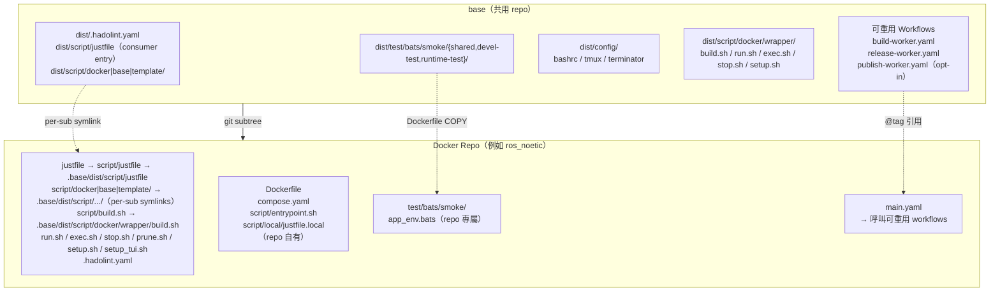
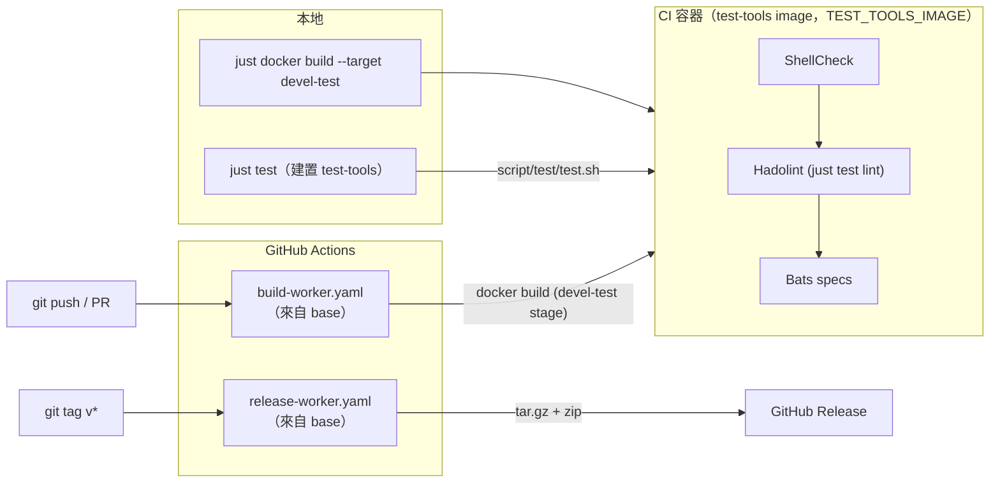

<!-- sync: base 1a496212d858 57f220f5b437 -->
# base

[](https://github.com/ycpss91255-docker/base/actions/workflows/self-test.yaml)


[](../../LICENSE)

[ycpss91255-docker](https://github.com/ycpss91255-docker) 組織下所有 Docker 容器 repo 的共用模板。

**[English](../../README.md)** | **[繁體中文](README.zh-TW.md)** | **[简体中文](README.zh-CN.md)** | **[日本語](README.ja.md)**

---

<!-- sync: table-of-contents 9cc5123f8582 c75921497c39 -->
## 目錄

- [TL;DR](#tldr)
- [必要條件](#必要條件)
- [概述](#概述)
- [日常使用](#日常使用)
- [各 repo runtime 配置](#各-repo-runtime-配置)
- [升級](#升級)
- [CI Reusable Workflows](#ci-reusable-workflows)
- [開發與測試](#開發與測試)
- [目錄結構](#目錄結構)

---

<!-- sync: tldr e3106fd287a0 84b6b4c30321 -->
## TL;DR

```bash
# 從零開始的新 repo：首個 commit + subtree + 一次性 bootstrap
mkdir <repo_name> && cd <repo_name>
git init
git commit --allow-empty -m "chore: initial commit"
git subtree add --prefix=.base \
    https://github.com/ycpss91255-docker/base.git vX.Y.Z --squash
./.base/dist/script/base/init.sh   # 一次性 bootstrap；之後用 just base init

# 升級
just base update    # 有沒有新 tag？
just base upgrade   # subtree pull + resync + workflow ref（見「升級」）

# 使用
just docker build   # 建置 image（需要時先跑 setup.sh）
just docker run     # 啟動 devel 容器
just                # 列出所有 namespace
```

`git subtree add` 需要 `HEAD` 存在。在剛 `git init` 且沒有任何 commit 的
repo 上會報錯 `ambiguous argument 'HEAD'` 與 `working tree has
modifications`；空 commit 建立 `HEAD` 後，subtree 才能 merge 進來。

<!-- sync: prerequisites 4fa4246972db da5f51f69d46 -->
## 必要條件

容器操作透過 [`just`](https://github.com/casey/just)（command runner）搭配
Docker 執行。使用 `just <verb>` 入口前，請先在 host 安裝兩者：

- **Docker** + Docker Compose v2（`docker compose`）。
- **just** -- 本 repo 只釘住一個版本。test-tools image、CI 與
  `--bootstrap-just` 安裝程式都使用該版本，因此同一個 recipe 在三處行為一致；
  用 `./.base/dist/script/base/just-version.sh` 印出版本（在本 repo 內為
  `./dist/script/base/just-version.sh`）。請用可指定版本的官方預編譯 binary
  安裝程式安裝該版本：

  ```bash
  pin="$(./.base/dist/script/base/just-version.sh)"
  curl --proto '=https' --tlsv1.2 -sSf https://just.systems/install.sh \
      | bash -s -- --to ~/.local/bin --tag "${pin}"
  ```

  host 套件管理器（`apt install just`、`brew install just`、
  `cargo install just`）是 **fallback 而非等價選項**：它安裝的是各自 registry
  收錄的版本，可能落後釘住的版本許多個 minor。完整方式見[官方安裝指南](https://github.com/casey/just#installation)。若
  `just` 不可用，每個 recipe 都有 raw fallback（`./script/<verb>.sh`、
  `./.base/dist/script/base/upgrade.sh`）-- 見[升級](#升級)。

<!-- sync: overview f0da6f1fe447 2465a63d98af -->
## 概述

此 repo 集中管理所有 Docker 容器 repo 共用的腳本、測試和 CI workflow。各 repo 透過 **git subtree** 拉入此模板，並使用 symlink 引用共用檔案。圖解導覽見 [doc/arch/overview.html](../arch/overview.html)。

<!-- sync: architecture 82511f59b040 de0391e5c627 -->
### 架構



<!-- sync: cicd-flow 45154f7b127c 3d26e785e964 -->
### CI/CD 流程



<!-- sync: whats-included a0d828952feb 2ce90fbe5be1 -->
### 包含內容

| 檔案 | 說明 |
|------|------|
| `script/build.sh` | 建置容器（`--setup` 有 TTY 時啟動 `setup_tui.sh`，否則呼叫 `setup.sh`） |
| `script/run.sh` | 執行容器（支援 X11/Wayland；`--setup` 語意與 `build.sh` 相同；`--build` 會先跑 `./script/build.sh test`，取得與 fresh-clone CI 相同的驗證） |
| `script/exec.sh` | 進入執行中的容器 |
| `script/stop.sh` | 停止並移除容器 |
| `script/prune.sh` | 清理這個 repo 的懸空 image / build cache |
| `script/setup_tui.sh` | 互動式 setup.toml 編輯器（dialog / whiptail 前端） |
| `dist/script/docker/wrapper/setup.sh` | 自動偵測系統參數並產生 `.env` / `.env.generated` + `compose.yaml` |
| `dist/script/docker/lib/_lib.sh` | 共用 helper（`_load_env`、`_compose`、`_compose_project` 等） |
| `dist/script/docker/lib/bootstrap.sh` | wrapper 共用初始化與參數解析 |
| `dist/script/docker/lib/compose.sh` | `docker compose` 呼叫包裝 + project 命名 |
| `dist/script/docker/lib/compose_emit.sh` | `compose.yaml` 產生器 |
| `dist/script/docker/lib/conf.sh` | setup.toml 讀寫（TOML；遷移時讀舊 INI） |
| `dist/script/docker/lib/toml_bridge.sh` | TOML parser 橋接（原生或容器化） |
| `dist/script/docker/lib/config_gen.sh` | Go 設定產生器的 shell 端（[ADR-00000039](../adr/00000039-config-generator-in-go.md)） |
| `dist/script/docker/lib/conf_logging.sh` | logging 配置 helper |
| `dist/script/docker/lib/env.sh` | 環境變數設定與預設值 |
| `dist/script/docker/lib/gitignore.sh` | gitignore 檔案管理 |
| `dist/script/docker/lib/hook.sh` | 各 wrapper 的 pre/post hook 呼叫 |
| `dist/script/docker/lib/i18n.sh` | 語言偵測與在地化（`_detect_lang`、`_LANG`） |
| `dist/script/docker/lib/log.sh` | 統一 logging 與輸出工具 |
| `dist/script/docker/lib/config_summary.sh` | runtime 配置摘要 |
| `dist/script/docker/lib/_tui_backend.sh` | `setup_tui.sh` 使用的 dialog / whiptail 包裝函式 |
| `dist/script/docker/lib/_tui_conf.sh` | setup.toml 值的 validator（`setup_tui.sh` 與 `setup.sh` 共用） |
| `dist/script/docker/runtime/logging.sh` | host 端 log tee helper（per-start 檔案 + 穩定 symlink） |
| `dist/script/docker/runtime/logrotate.sh` | 共用 rotate/symlink/prune primitives（tee + transcript 共用） |
| `dist/script/docker/runtime/watchdog.sh` | 通用單服務 watchdog（重啟 + 可插拔健康檢查） |
| `dist/script/docker/runtime/entrypoint.sh` | base 的 ENTRYPOINT orchestrator：開 log tee、source repo bringup、arm watchdog、exec workload |
| `dist/dockerfile/entrypoint.sh` | bringup 範本，建立新 repo 時 seed 成 `script/entrypoint.sh`（repo 那一半，由 orchestrator source） |
| `dist/test/bats/smoke/smoke.sh` | runtime install-check smoke（ldd 缺依賴掃描） |
| `script/test/test.sh` | base 自身測試 dispatcher（本地 + 容器內） |
| `script/test/drivers/` | 每個 lint/test 工具一支 driver |
| `script/test/lint_bare_stderr.sh` | Bare stderr lint 檢查 |
| `config/` | Container 內部 shell 設定檔（bashrc、tmux、terminator） |
| `setup.toml` | 單一 per-repo runtime 配置（image / build / deploy / gui / network / volumes） |
| `dist/test/bats/smoke/` | 共用 smoke 測試 + runtime assertion helpers（[dockerfile-stages.md](../guide/dockerfile-stages.md#smoke-test-helpers-for-downstream-repos)） |
| `test/bats/unit/` | base 自身測試，Unit 層（bats + kcov） |
| `test/bats/integration/` | base 自身測試，Integration 層（init/upgrade 端對端） |
| `test/bats/system/` | base 自身測試，System 層／Regression（runtime smoke gate，opt-in） |
| `test/bats/acceptance/` | base 自身測試，Acceptance 層（UAT/OAT；保留，S5 #785） |
| `.hadolint.yaml` | 共用 Hadolint 規則 |
| `justfile`（→ `script/justfile`） | Repo 指令入口 — 分層 namespace recipe（`just docker build`、`just docker run`、`just test`、`just base upgrade` 等）。Sub-cmd 與 flag 原封不動轉交（`"$@"`），例如 `just docker build --no-cache --target devel`；無參的 `just` 列出所有 namespace。 |
| `dist/script/docker/justfile.docker` | `docker` namespace — 容器操作（`just docker build/run/start/exec/stop/prune/setup/setup-tui`）。 |
| `dist/script/base/justfile.base` | `base` namespace — 管理 `.base` subtree（`just base init/update/upgrade/completions`）。 |
| `dist/script/base/init.sh` | 首次初始化 symlinks + 新 repo 骨架產生（bootstrap：`./.base/dist/script/base/init.sh`；之後改用 `just base init`）。 |
| `dist/script/base/upgrade.sh` | Subtree 版本升級（`just base upgrade [vX.Y.Z]`）。 |
| `script/test/justfile.test` | base 自身測試入口（`just test`、`just test lint`、`just test coverage` …）。 |
| `script/release/justfile.release` | base `release` namespace（release / publish 工具）。 |
| `script/watch/justfile.watch` | base `watch` namespace — 上游發佈監控（`just watch`、`just watch pins`、`just watch bump <name> <version>`）。 |
| `dist/dockerfile/Dockerfile` | 新 repo 的多階段 Dockerfile 範本 |
| `dockerfile/Dockerfile.test-tools` | 預建置 lint/test 工具 image（shellcheck、hadolint、bats、kcov） |
| `dockerfile/Dockerfile.config-gen` | 建置 Go 設定產生器（`config-gen`；只負責 provisioning，`compose.yaml` 仍由 `compose_emit.sh` 產生） |
| `dockerfile/config-gen/go.mod` | Go 設定產生器的 module（[ADR-00000039](../adr/00000039-config-generator-in-go.md)） |
| `.github/workflows/` | 可重用 worker + base 自身 CI |

測試內容採 **tool-first** 配置 -- spec 走 `test/<tool>/<category>/`
（例如 `test/bats/unit/`）、linter 走 `test/lint/<tool>/` --
新增一個工具就是開一個新資料夾，而非新增一個指令面。分類詞彙對齊 ISTQB
（Unit / Integration / System / Acceptance 四個層級 + Smoke 類型）；見
[ADR-00000018](../adr/00000018-istqb-test-taxonomy.md) 與
[ADR-00000012](../adr/00000012-tool-first-test-layout.md)（取代 category-first
的 ADR-00000004）。consumer 出貨自己的 `test/bats/smoke/`；base 出貨自己的
`test/bats/{unit,integration,system,acceptance}/`。

<!-- sync: what-stays-in-each-repo-not-shared dc4a422e6bf1 602edf4e5128 -->
### 各 repo 自行維護的檔案（不共用）

- `Dockerfile`
- `compose.yaml`
- `script/` — repo 本地的 **runtime helpers**（在 container 內被 `ENTRYPOINT` / `CMD` 或人工呼叫）
  - `script/entrypoint.sh` — 這個 repo 的 **bringup**，由 base 的 orchestrator source；它本身不是 `ENTRYPOINT`（見 [entrypoint.md](../guide/entrypoint.md)）
  - 任何 ros / app 啟動 helper 等
- `script/docker/` — repo 本地的 **Dockerfile-internal build helpers**（在 Dockerfile `RUN` 階段呼叫，container 啟動後不會用到；範例與 lint COPY 見 `dist/dockerfile/Dockerfile`，#275）
- `doc/` 和 `README.md`
- Repo 專屬的 smoke test

<!-- sync: everyday-use 2010a1303130 91293efc771f -->
## 日常使用

「namespace vs recipe 的說明」與「Wrapper UX 速查表（#291）」兩節只有英文版；
請看 [README.md](../../README.md#everyday-use)。

<!-- sync: per-repo-runtime-configuration 4f345e108457 8709ab924d8a -->
## 各 repo runtime 配置

每個下游 repo 透過一個 `setup.toml` 驅動自己的 runtime 配置
（GPU 保留、GUI env/volumes、network mode、額外 volume mounts）。
`setup.sh` 讀它 + 系統偵測後重新產生 `.env`、`.env.generated` 與
`compose.yaml`，這些衍生檔使用者不用動手編輯。`.env.local` 才是另一個檔：
setup 只在第一次 scaffold，之後永不覆寫，你自己的值放在那裡。

這些檔案分成三組：

- **每次 `setup.sh apply` 都重新產生**：`compose.yaml`、`.env.generated`、
  `.env`。不要手改。
- **repo 自有、永不覆寫**：`setup.toml` 與 `Dockerfile`。工具只在你要求時
  （`just docker setup set`、TUI）才寫 `setup.toml`；升級時的具名 migration
  列在 [upgrade.sh 會改寫你 repo 裡的哪些檔案](#upgradesh-會改寫你-repo-裡的哪些檔案)。
- **本機**、gitignored、屬於你：`setup.local.toml` 與 `.env.local`。

`.env.generated` 保留後綴的理由不同 —— 它只餵 compose 的 `${VAR}` 插值、
從不進容器，後綴標的是類別而非歸屬。

首次執行 `setup.sh`（尚無 per-repo `setup.toml`）時，template 檔會被
複製到 `<repo>/setup.toml`，並把偵測到的 workspace 寫入**第一個
`[[volumes]]` block** —— 也就是 `volumes.mount_1` 所指的那一個。後續執行以
`mount_1` 為真實來源；清空該欄即可放棄掛 workspace。
`./.base/dist/script/base/init.sh --gen-conf` 做同樣的單純複製，該檔已存在時
會拒絕（`--force` 會先備份成 `setup.toml.bak`）。

<!-- sync: one-conf-15-sections a6f1ae3719e2 4dd8a551c73a -->
### 單一 conf、15 個 section

下面這份 section 清單不是散文，而是 `SCHEMA_SECTIONS`
（`dist/script/docker/lib/schema.sh`）— 「有哪些 section、順序為何」的唯一
來源。這個區塊或它的數量一旦與程式碼不一致，`derived-figures` lint 會失敗。

```
[project]  name — 這個 checkout 執行時所屬的 compose project（留空 =
           推導出 <DOCKER_HUB_USER>-<IMAGE_NAME>）。想同時跑兩個
           checkout，就在 setup.local.toml 依 WORKTREE 各自設定
[image]    rules = prefix:docker_, suffix:_ws, @basename
[build]    apt_mirror_ubuntu、apt_mirror_debian            # Dockerfile build args
[deploy]   gpu_mode (auto|force|off)、gpu_count、gpu_capabilities
           dri_groups (auto|off) — GUI service 上 iGPU /dev/dri 的 group_add
[lifecycle] restart (no|always|unless-stopped|on-failure|on-failure:N)
           預設 unless-stopped;屬於 DEPLOY 範疇 — 見
           doc/guide/lifecycle.md。init (true|false) — Docker init/PID1
           reaper;預設 true。watchdog_* — 容器內健康檢查（opt-in）
[gui]      mode (auto|force|off)
[network]  mode (host|bridge|none)、ipc、pid (host|private)、privileged
           port_N = host:container（只有 bridge 模式才會 publish）
[security] privileged（false）、cap_add_N、cap_drop_N、security_opt_N
           （以及對應的 *_inherit 開關;預設精簡，要用才開）
[resources] shm_size
[environment] env_N = KEY=VALUE — set-once 預設值，寫進產生的 .env
           並 bake 成 deployable stage 的 ENV;每次任務都會變的變數請放
           .env.local
[tmpfs]    tmpfs_N = /path[:size=N] — RAM-backed 掛載點
[devices]  device_N = host:container，以及 cgroup rule（要用才開）
[volumes]  mount_1（workspace，首次執行時自動填入）
           mount_2..mount_N（額外 host mount；裝置走 /dev path）
[additional_contexts] context_N = name=source — 額外的具名 build context
[logging]  driver（預設 json-file）、max_size、max_file、compress
           local_path（host 端 log 目錄；bind-mount 到 /var/log/<repo>）
           container_log_keep (20)、container_log_days (14)（每次啟動的
           容器 log 保留策略；keep-count 與 age 兩者取嚴）
           wrapper_transcript（把 verb 輸出 tee 到 log/<verb>/；預設 true）、
           wrapper_transcript_keep (20)、wrapper_transcript_days (14)
           [logging.<svc>] 可對單一 service 做 key-level override
```

上面這些方括號名稱是 section 名冊，不是檔案語法。純量 section 是 TOML 的
`[table]`；清單形式的 section 是 `[[array of tables]]`，其中第 N 個 block
就是 `<prefix>_N` 所指的那一個 —— `volumes.mount_1` 就是第一個
`[[volumes]]` block。

Template default 在 `.base/dist/setup.toml`；per-repo 覆蓋放
`<repo>/setup.toml`（由 `just docker setup` 工具管理，刻意不放進手動編輯的
`config/` 介面）。合併是**型別感知**的
（[ADR-00000037](../adr/00000037-toml-config-format-unification.md)）：
`[table]` 內的純量鍵走 key-level 合併 —— 定義該鍵的最上層勝出，它沒提到
的鍵則從下層繼承 —— 而 `[[array of tables]]` 由定義它的最上層整份取代。
沒有任何一層提到的 section 則往下層落。

<!-- sync: three-layers-the-third-is-yours-setuplocaltoml 0140754d2189 c75dad55573f -->
#### 三層設定，第三層是你的（`setup.local.toml`）

| 層 | 是否進版控 | 屬於誰 |
|---|---|---|
| `.base/dist/setup.toml` | 隨 subtree 出貨 | base 的預設 |
| `<repo>/setup.toml` | 已 commit | repo 的 —— CI 與其他所有 checkout 用的就是它 |
| `<repo>/setup.local.toml` | **gitignored** | 你的，只在這台機器、這個 worktree |

三層共用同一套語法、同一條型別感知合併規則。第三層用 `--local` 寫：

```bash
just docker setup set --local project.name myrepo-wt2
```

清單是整份取代而不是逐項合併，因為對有序清單做半套覆蓋，永遠無法移除某一項，
還會拼出哪一層都沒寫過的組合。由此衍生三件事，而且全都會出聲、不會默默發生：

- `setup.local.toml` 已定義某 section 時，用一般的 `set` 寫該 section 會
  **警告**並指名該 section。不會拒絕 —— 那個值仍然是 CI 與其他 checkout
  會用的 committed 值 —— 但它在這台機器上不會有任何效果。
- 每個 wrapper 執行前的摘要都會多一行 `local override:`，列出檔案與被它
  取代的 section。
- `just docker setup deploy` 只要該檔存在就**拒絕執行**（見
  [field-deploy.md](../guide/field-deploy.md)）。

<!-- sync: topic-guides 8ef0959e6ba4 2a2ba60b7a0b -->
### 主題指南

每個深入主題各有一頁，放在 `doc/guide/`（僅英文；英文 README 為準）：

- [Dockerfile stages](../guide/dockerfile-stages.md) -- stage 表、bake 到
  `/opt` 的 artifact、額外 stage、`[stage:<name>]` 覆寫與 smoke 測試 helper。
- [Container entrypoint](../guide/entrypoint.md) -- base 的 orchestrator、
  你的 bringup，以及一次性的 `ENTRYPOINT` 遷移。
- [Container lifecycle](../guide/lifecycle.md) -- 同時跑兩個 worktree、
  network mode、restart policy、init 與 watchdog。
- [參數放哪裡](../guide/env-vs-workload.md) -- `setup.toml`、`.env.local`、
  `config/<component>/` 各自負責什麼。
- [Field 部署](../guide/field-deploy.md) -- `just docker setup deploy` 與
  自帶式 bundle。
- [Logging](../guide/logging.md) -- 容器 log 輸出到 host 與 wrapper transcript。
- [setup.sh 流程](../guide/setup-workflow.md) -- TUI、host 偵測覆寫與各 wrapper 的 hook。
- [命名規則](../guide/naming.md) -- image、project、container 名稱，以及唯一的
  `container_name` 例外。
- [publish-worker.yaml 與 source archive](../guide/publish-worker.md)。

開發 stack 不 emit `container_name:`，唯一的例外是 field deploy bundle（`just docker setup deploy`），它確實會寫死一個 `container_name:` —— 見 [naming.md](../guide/naming.md)。

<!-- sync: when-setupsh-runs c467aa1f8353 d187feccc9e0 -->
### setup.sh 什麼時候跑

`setup.sh` 不會在每次 build / run 都重跑，但也不是只有你明確要求時才
跑 — 以下都會觸發它：

- **`just base init` / `./.base/dist/script/base/init.sh`** 建完骨架自動跑一次
- **`just base upgrade` / `./.base/dist/script/base/upgrade.sh`** subtree pull 後透過 init.sh
  再跑一次，所以升級永遠會用新版 baseline 重新產出 `.env` /
  `.env.generated` / `compose.yaml`
- **`just docker build --setup` / `just docker run --setup`**（或 `-s`）— 手動觸發重跑
- **首次 bootstrap**：`just docker build` / `just docker run` 首次執行
  （`.env.generated` 尚未存在，例如 CI 新 clone）會自動跑 setup.sh，不用帶
  `--setup`
- **Drift**：每次 build 與 run 都會先跑 `setup.sh check-drift` — 見
  [Drift 偵測](#drift-偵測)

> **Fresh-clone lint 覆蓋率（#216）**：`just docker run` 在本機沒 image
> cached 時會走 Compose auto-build — 但 auto-build **只 build
> `target: devel`**（或 `-t` 指定的 target），會跳過 `target:
> devel-test` 那層的 ShellCheck / Hadolint / Bats smoke。`run.sh` 偵測到
> 這個情況會印一段 `[run] INFO:` 提醒（只在 TTY 環境）。想要一次取得跟 CI
> 同樣的完整驗證，加 `--build` flag：
>
> ```bash
> just docker build test                   # 顯式跑 lint + smoke
> just docker run --build                  # 跑完 lint + smoke 再 compose up
> just docker run                          # 預設 — 快速路徑，跳過 lint/smoke
> ```

`setup.sh apply` 每次都會從頭重生 `compose.yaml`，但會保留既有
`.env.generated` 中的 `WS_PATH` / `APT_MIRROR_UBUNTU` /
`APT_MIRROR_DEBIAN`，所以手動調過的 workspace 路徑或 apt mirror 升級時
不會被蓋掉。

<!-- sync: drift-detection 2ebe5e1725e2 febed315a2c6 -->
### Drift 偵測

`setup.sh apply` 會把五個值寫進 `.env.generated`：`SETUP_CONF_HASH`、
`SETUP_DOCKERFILE_HASH`、`SETUP_GUI_DETECTED`、`GPU_ENABLED`、`USER_UID`。
每次 `just docker build` / `just docker run` 都會拿這些值跟當前的 tree 與
host 比對，任一項自上次 setup 後改變就印 `[WARNING]`（不阻擋執行）：

- `setup.toml` 內容（`SETUP_CONF_HASH`）
- Dockerfile stage 清單（`SETUP_DOCKERFILE_HASH`）— 新增或移除
  `FROM ... AS <stage>`
- GPU 偵測結果（`GPU_ENABLED`）
- GUI 偵測結果（`SETUP_GUI_DETECTED`）
- `USER_UID`（使用者身份改變）

不需要手動重跑：wrapper 會跑 `setup.sh check-drift`，報出 drift 時自行重新
產生 `.env` / `.env.generated` / `compose.yaml` — 這些都是衍生檔，不含使用者
資料，重生永遠安全。帶 `--setup` 可以立刻強制重生，在 TTY 下會先開
`setup_tui.sh`。

<!-- sync: setupsh-subcommands f2810d447771 cfbdbc49e21d -->
### setup.sh 子指令

`setup.sh` 是 git 風格的後端，提供明確的子指令，入口是
`just docker setup <子指令>`。build / run / TUI 腳本會代為呼叫；直接呼叫適合
腳本化／非互動情境：

| 子指令 | 用途 |
|---|---|
| `apply` | 從 setup.toml + 系統偵測重新產生 `.env` + `.env.generated` + `compose.yaml`（不會動 `.env.local`） |
| `check-drift` | 同步回 0、漂移回 1（漂移描述印到 stderr） |
| `set <section>.<key> <value>` | 寫單一鍵值。`--local` 改寫 gitignored 的 `setup.local.toml` 而非已 commit 的 `setup.toml`；不加時，若寫的 section 已被 `setup.local.toml` 定義會指名警告 |
| `show <section>[.<key>]` | 讀單鍵或整 section |
| `list [<section>]` | key = value 形式的 dump |
| `add <section>.<list> <value>` | 加到清單型 section（`mount_*` / `env_*` / `port_*` …）；優先填空 slot，否則用 `max+1`。可加 `--local` |
| `remove <section>.<key>` / `<section>.<list> <value>` | 按 key 或按值刪除。可加 `--local` |
| `reset [-y\|--yes]` | 回復 template 預設；舊 `setup.toml` → `setup.toml.bak`、舊 `.env.generated` → `.env.generated.bak`。不會動 `.env.local` |
| `deploy [--stage S] [-y] [--dry-run] [--allow-local-override]` | 打包 field 部署 bundle；見 [field-deploy.md](../guide/field-deploy.md) |

有型別的鍵會走 `_tui_conf.sh` 的 validator（與 TUI 同一套）。`set` / `add` /
`remove` / `reset` **不**會自動重新產 `.env.generated` — 需要時自行接
`apply`，或下次 build / run 偵測到 drift 也會自動重產。無參數的 `setup.sh`
只印 help：v0.11.0 拿掉隱式 `apply` 的紀錄見
[doc/deprecations.md](../deprecations.md)。

<!-- sync: derived-artifacts-gitignored a3a31b52be28 aa89eb3d4fc7 -->
### 衍生檔（gitignored）

- `.env.generated` — compose 插值用的變數（含解析後的 `PROJECT_NAME`）
  + `SETUP_*` drift metadata;從不進容器
- `.env` — 進容器的預設值：`[environment]` 清單與 `[lifecycle] watchdog_*`
  區塊，以填好的清單呈現
- `compose.yaml` — 含 baseline 與條件區塊的完整 compose

任何時候打開 `compose.yaml` 都能看到當下完整 runtime 配置。每次
`just base upgrade` 都會重生這三個檔（init.sh 在 subtree pull 後重跑
`setup.sh apply`）— 不要手改，需要 override 寫到 `setup.toml`。

`.env.local` 一樣被 gitignore，但**不是**衍生檔：它是你的，第一次 apply 時
scaffold 一次，之後永不覆寫。可以放心編輯，跑 setup 也不會蓋掉。compose 在
`.env` 之後才載入它，所以同名 key 以你的值為準。

> **從 v0.43.0 之前升級**：`.env` 以前是手寫檔。`just base upgrade` 會在任何
> 東西重生它之前，先幫你把手寫的 `.env` 改名成 `.env.local`。若你略過那條
> 升級路徑而先跑了 `setup`，只有當該檔是舊的插值 cache 時值才會留在
> `.env.bak`，否則請從自己的備份還原。

`setup.local.toml` 在上一層是同樣的形狀：gitignored、屬於你、工具永不改寫。
它是設定的*輸入*而不是產出 —— 見
[三層設定](#三層設定第三層是你的setuplocaltoml)。

<!-- sync: upgrading 56de8c94ebd2 e24746b65253 -->
## 升級

<!-- sync: updating 0c4663a7ac2e 560bb9d0e25e -->
### 更新

前置條件：`git config user.name` / `user.email` 必須有設，working tree
不能在進行中的 merge / rebase / cherry-pick / revert — upgrade.sh 會
fail-fast 帶可操作訊息，避免半套 pull。

```bash
# 檢查是否有新版
just base update

# 升級到最新（subtree pull + 版本檔 + workflow tag）
just base upgrade

# 或指定版本
just base upgrade v0.3.0
# 指定的版本若比目前 local 還舊（例如從 v0.12.0-rc1 退回 v0.11.0）會被
# 視為隱式 downgrade 拒絕（依 SemVer §11）。如果是刻意要 rollback，自
# 行手改 .base/.version。

# 沒有 just 時的 fallback
./.base/dist/script/base/upgrade.sh v0.3.0
```

`upgrade.sh` 一次完成。**它會寫入你的 repo，而且其中一部分寫的是你自己的
檔案** — 如果這個 repo 有正在跑的 field 部署，請先讀
[upgrade.sh 會改寫你 repo 裡的哪些檔案](#upgradesh-會改寫你-repo-裡的哪些檔案)。流程：

1. `git subtree pull --prefix=.base ... --squash`，commit 訊息為
   `chore: upgrade .base subtree to <version>`
2. Post-pull 完整性檢查 — subtree marker（`.base/.version`、
   `.base/dist/script/base/init.sh`、`.base/dist/script/docker/wrapper/setup.sh`）若不見了會
   `git reset --hard` rollback（防舊版 `git-subtree.sh` destructive FF）
3. `./.base/dist/script/base/init.sh` 重跑：重整 `script/*.sh` wrapper symlink
   與根目錄的 `justfile`、移除已退役的根目錄連結、執行依版本區間選出的具名
   migration、把 `.gitignore` 同步到 canonical entry set、
   `git rm --cached` 已經變成 derived artifact 的舊 tracked 檔
   （`.env.generated`、`compose.yaml`、…），最後呼叫 `setup.sh apply`
   重生 `.env.generated` + `compose.yaml`
4. `sed` 改寫 `.github/workflows/main.yaml` 裡每一個
   `ycpss91255-docker/base/.github/workflows/<file>@vX.Y.Z` ref，連同步驟 3
   的變更一起 commit 為 `chore: update template references to <version>`
5. `apply_migrations`（`lib/dockerfile_migrate.sh`）修補 **repo 根目錄的
   `Dockerfile`** 與 **`script/entrypoint.sh`**（base contract 在它們底下
   改變時），並把結果放進與步驟 3-4 同一個 commit

不要手動 `git subtree pull` — 完整性檢查、init.sh resync、sed 與 migration
步驟很容易漏掉。

**pull 之後任何一步失敗，整個升級都會被還原。** pull 會先 commit，步驟
2-5 才跑，所以以前在那裡中斷會留下一個「版本號已經跳、resync 從沒跑過」
的 repo — 一堆斷掉的 wrapper 配上乾淨的 `git status`。現在整個 run 會
reset 回它開始時的 commit，並把自己建立的檔案清掉，失敗的升級留下的是
「沒有任何變化，加上一個錯誤」。你手上未 commit 的東西不會有風險：
`git subtree` 本來就拒絕在 dirty tree 上啟動，所以 pull 之後出現的每個
變更都是這次升級自己造成的。

> **從 `v0.41.0`（或更早）升級到已經搬過檔案的 tree。** 驅動升級的腳本
> 是你自己 `.base/` 裡 vendored 的那一份，所以實際跑的是舊 release 的版
> 本。`v0.41.0` 以前的 release 呼叫 `./.base/init.sh`，而 `dist/` 重整
> 把它搬走了；舊路徑上的相容轉發器讓它們繼續可用。如果你已經踩到這個失
> 敗（`.base/.version` 已經跳版、`just --list` 說找不到 justfile），沒
> 有任何東西損壞 — 只是 resync 沒跑到。手動跑一次並 commit：
>
> ```bash
> ./.base/dist/script/base/init.sh
> git add -A && git commit -m "chore: resync .base wrappers"
> ```

<!-- sync: pointing-base-at-a-different-upstream 9621cc89b4d5 ce40d4379aa5 -->
#### 把 `.base` 指到別的 upstream

`TEMPLATE_REMOTE` 是所有 `.base` 操作讀的 git remote：查「有沒有新 tag」
以及那個會改寫你 working tree 裡 `.base/` 的 `git subtree pull`。預設是
`https://github.com/ycpss91255-docker/base.git` — 用 HTTPS，所以剛 clone
的環境、CI runner、第一次貢獻而沒有 SSH key 的人都能直接跑。這個預設值只
定義在一個地方：`.base/dist/script/base/upstream.sh`；`TEMPLATE_REMOTE`
則是逐次呼叫的覆寫。

```bash
# 改用 SSH（agent 認證，或只能用 SSH 連到的 fork）
TEMPLATE_REMOTE=git@github.com:ycpss91255-docker/base.git just base upgrade

# 你自己維護的 private fork：這個 repo 追的是「你的」base
TEMPLATE_REMOTE=git@github.com:acme/base.git just base upgrade v1.2.0
```

**`.base/dist/` 底下的每個檔案都是從這個 URL 抓下來、然後被執行的** —
wrapper、lib、Dockerfile、entrypoint 都是。只把它指向你信任程度等同自己
repo 的來源：控制那個 repo 的人，就控制了你下次 `just docker build` 跑的東西。
這也是它被設計成逐次呼叫的環境變數、而不是 conf key 的原因 — 改指向這件事
會留在你看得到的那行指令裡，而不是躺在某個檔案裡默默影響之後每一次升級。
長期維護的 fork 應該明確寫進你自己的工具鏈，而不是在 shell profile 裡
export。

每週的升級「提醒」（`check-base-version.sh`）讀的是另一個變數 `BASE_REPO`；
見 [CONTEXT.md](../../CONTEXT.md) 的 base version monitor。

<!-- sync: what-upgradesh-rewrites-in-your-repo a9b5fd89f4c4 b50d281ea1d7 -->
#### upgrade.sh 會改寫你 repo 裡的哪些檔案

`.base/` 是 base 的，其他都是你的。即使如此，升級對 `.base/` 以外**並非**
唯讀：無法在 subtree 內部吸收的 base contract 變更，會改在你的檔案上修補，
而且 upgrade.sh 是用 **commit** 的方式做，所以這些變更會以你的名義進入你的
history。過程都會印在 stdout，不是靜默的 — 但訊息會捲過去，所以完整清單如下。

| 時機 | 改寫什麼 | Commit 訊息 |
|---|---|---|
| 步驟 1 | `.base/`（subtree pull） | `chore: upgrade .base subtree to <version>` |
| 步驟 3 | 搬遷前的 `config/docker/setup.conf` 移到根目錄的 `.setup.conf`（兩者都存在時合併，`lib/setup_conf_migrate.sh`） | 併入步驟 4 的 commit |
| 步驟 3 | 舊 INI 格式的 `.setup.conf` 轉成 `setup.toml`（`lib/ini_to_toml_migrate.sh`） | 併入步驟 4 的 commit |
| 步驟 3 | 手寫的 `.env` 改名成 `.env.local` | 併入步驟 4 的 commit |
| 步驟 3 | `setup.toml` 的 `[lifecycle] restart = "no"` → `"unless-stopped"`，依跨越的版本區間選出（`lib/version_migrate.sh`） | 併入步驟 4 的 commit |
| 步驟 3 | `.gitignore` canonical entry；`git rm --cached` 已變成 derived 的檔案 | 併入步驟 4 的 commit |
| 步驟 4 | `.github/workflows/main.yaml` 的 worker `@vX.Y.Z` ref | `chore: update template references to <version>` |
| 步驟 5 | repo 根目錄的 `Dockerfile`、`script/entrypoint.sh`（`apply_migrations`） | 併入步驟 4 的 commit |

> **restart 這條 migration 會改變 runtime 行為。** `[lifecycle] restart`
> 以前屬於 devel 範疇、template 預設是 `no`，而 `init.sh --gen-conf` 會整份
> 複製 template，所以幾乎每個 repo 都帶著一個沒有人真的選過的
> `restart = no`。這個 key 現在屬於 deploy 範疇（見
> [lifecycle.md](../guide/lifecycle.md#restart-policy-is-deploy-scoped-841)），
> 那個被複製過來的 `no` 因此在結構上就是過期的。所以它會被改寫 —
> **原本 host 重開機後不會自己起來的 deployable stage 容器，之後會自己起來。**
> 它只在版本區間跨越這次 rescope 的那一次升級執行，只在你的值剛好是 `no` 時
> 觸發，選過其他值的 repo 一律不動。若 `no` 才是你要的，升級後改回去；之後
> 不會再被改寫。

**升級後想確認到底動了哪些檔案：**

```bash
git log --oneline <升級前的 sha>..HEAD          # 依名稱列出升級 commit
git diff <升級前的 sha>..HEAD -- . ':!.base'    # .base/ 以外的所有變更
```

upgrade.sh **不會**動的：`setup.toml` 裡除了上面這些 migration 以外的內容，
以及 `<repo>/config/`（bashrc / tmux / terminator …）完全不動 —
若上游 `.base/dist/config/` 或 `.base/dist/setup.toml` 自上次 pull 後有變動，
upgrade.sh 會印出 `diff -ruN .base/dist/config config` 提示，由你自行
reconcile，而不是替你合併。

<!-- sync: automated-version-bumps-optional 885a5a03faa6 7e7d5ea23258 -->
#### 自動升版（選用）

Dependabot 可以在 base 出新 tag 時自動開 PR：加一個 `.github/dependabot.yml`，
用 `github-actions` ecosystem、`directory: "/"`。它只會更新 `main.yaml` 裡的
`uses: ycpss91255-docker/base/...@vX.Y.Z` ref；subtree 本身仍需在本地跑
`just base upgrade vX.Y.Z`。

<!-- sync: ci-reusable-workflows 5b9ed4f4572c ea51bc546a4b -->
## CI Reusable Workflows

下游 repo 從 `.github/workflows/main.yaml` 呼叫這些 reusable workflow：

```yaml
# .github/workflows/main.yaml
jobs:
  call-docker-build:
    uses: ycpss91255-docker/base/.github/workflows/build-worker.yaml@vX.Y.Z
    with:
      image_name: my_app
      build_args: |
        BASE_IMAGE=python:3.11-slim
        APP_VERSION=1.0
        DEBIAN_CODENAME=bookworm

  call-release:
    needs: call-docker-build
    if: startsWith(github.ref, 'refs/tags/')
    permissions:
      contents: write
    uses: ycpss91255-docker/base/.github/workflows/release-worker.yaml@vX.Y.Z
    with:
      archive_name_prefix: my_app
```

<!-- sync: build-workeryaml-common-inputs 22209d9818e6 3c10a1172101 -->
### build-worker.yaml 常用參數

| 參數 | 類型 | 必填 | 預設值 | 說明 |
|------|------|------|--------|------|
| `image_name` | string | 是 | - | 容器映像名稱 |
| `build_args` | string | 否 | `""` | 多行 KEY=VALUE 建置參數 |
| `build_runtime` | boolean | 否 | `true` | 退出 runtime 建置(`false`)。stage 是否存在改由 Dockerfile 決定:有宣告 `runtime` / `runtime-test` 才建置,沒有就跳過,所以沒有 runtime stage 的 repo 不必改這一項 |
| `platforms` | string | 否 | `"linux/amd64"` | 逗號分隔的目標平台；每個會在原生 runner 上平行跑（`linux/amd64` → ubuntu-latest、`linux/arm64` → ubuntu-24.04-arm） |

全部 11 個參數：見 `.github/workflows/build-worker.yaml` 的
`on.workflow_call.inputs`
（[ADR-00000028](../adr/00000028-documentation-is-derived-not-duplicated.md)）。

`devel-test` / `runtime-test` stage 建置時 FROM 的工具映像不是參數。它由
worker 以自身 ref 取出的 base checkout 中的 `.version` 推導而來，那也是
`release-test-tools.yaml` 發佈該映像所用的 tag——所以你釘住 worker 的
`@vX.Y.Z`，同時也釘住了工具映像。這件事以前由 `test_tools_version` 參數
承載，預設是滾動的 `latest`；仍在傳該參數的呼叫端必須移除那一行。

<!-- sync: release-workeryaml-inputs 89f7de4f5d1a 942b3438f5a6 -->
### release-worker.yaml 參數

| 參數 | 類型 | 必填 | 預設值 | 說明 |
|------|------|------|--------|------|
| `archive_name_prefix` | string | 是 | - | Archive 名稱前綴 |
| `extra_files` | string | 否 | `""` | 額外檔案（空格分隔） |
| `version` | string | 否 | `""` | 要發布的版本（`vX.Y.Z`）。走 tag 觸發路徑時留空，版本會從所推的 tag 讀出。若要從非 tag 的 run 直接呼叫這個 worker 就傳入它：用預設 `GITHUB_TOKEN` 產生的事件不會啟動新的 workflow run，所以要自動發布已合併變更的 repo，靠推 tag 到不了這裡。不是 `vX.Y.Z[-suffix]` 的值會被拒絕，而不是照樣拿來發布 |

`publish-worker.yaml`（opt-in，給其他 repo 會 `FROM` 的基礎 image repo）在推
tag 時把 Dockerfile 的某個 target stage 推到 registry；它的參數、多變體的呼叫
範例，以及 base release 的 source archive 與下游 release 有何不同，見
[publish-worker.md](../guide/publish-worker.md)。

<!-- sync: development-and-tests 750400f91f7b 81ccfd0d12ef -->
## 開發與測試

在 base checkout 內（`script/test/justfile.test`）：

```bash
just test               # 所有 linter + Bats（no kcov），透過 docker compose
just test lint          # lint 階段的全部 linter
just test lint --shellcheck   # 只跑一個 linter（--hadolint、--readme-sync、...）
just test coverage      # Bats 全套跑在 kcov 下；不跑 lint 階段
just test coverage-local      # 同樣的 kcov 執行，本機 in-job 模式
just test go            # Go config-gen：build、lint、test、覆蓋率 floor、mutation
just test system        # opt-in 的 System 層（需要 host docker）
just test acceptance    # Acceptance 層：真的 scaffold 一個 consumer
just test smoke         # 出貨的 smoke spec
just release coverage-badge   # 從 coverage/ 重新產生 doc/badge/coverage.svg
```

覆蓋率徽章是 Bats 全套對 Bash 原始碼量到的 kcov 行覆蓋率，每次 release 量一次；
Go 套件由各自的 per-package floor 把關（`just test go`）。量測方式見
[ADR-00000008](../adr/00000008-coverage-sharded-pr-gate.md)，測試索引見
[TEST.md](../test/TEST.md)（各類型清單：[unit](../test/unit.md) /
[integration](../test/integration.md) / [system](../test/system.md) /
[acceptance](../test/acceptance.md) / [smoke](../test/smoke.md)），所有 recipe
見 `script/test/justfile.test`。

<!-- sync: directory-structure ab00213e0736 76da8c3d0d47 -->
## 目錄結構

```
.base/                                  # subtree 釘在 consumer 的 <repo>/.base/
├── .version                            # 釘住的 base release tag
├── justfile                            # base 自身的入口（mods test / release / watch）
├── compose.yaml                        # base CI runner（test-tools 服務）
├── dist/                               # 出貨內容：setup.toml、env.toml、.hadolint.yaml、
│                                       #   config/、dockerfile/、script/{docker,base,template}/、
│                                       #   deploy/（cd-guard + bundle README）、test/bats/smoke/
├── script/                             # base 自身的工具：test/、release/、watch/、ci/
├── dockerfile/                         # Dockerfile.test-tools / .config-gen / .smoke /
│                                       #   .toml-bridge、config-gen/ Go module、kcov patch
├── test/                               # base 自身 spec：bats/{unit,integration,system,acceptance}/
├── .github/                            # 可重用 worker + base CI workflow、dependabot.yml
├── doc/
│   ├── badge/                          # 產生的發布覆蓋率徽章（release 時 hand-run，bump caller 待接：docker_harness#289）
│   ├── guide/                          # README 連過去的主題指南
│   ├── readme/                         # README 翻譯（zh-TW / zh-CN / ja）
│   ├── adr/                            # Architecture Decision Records
│   ├── arch/                           # 架構圖（自帶式 HTML）
│   ├── test/                           # 測試索引 + 各層級 spec 清單
│   ├── changelog/                      # 生成的索引之下，每個 0.Y 系列一個檔案
│   └── deprecations.md
├── CONTEXT.md
├── LICENSE
└── README.md
```


<!-- Sections of the English README.md that this abridged translation
     deliberately does not carry. Declared, not forgotten: the sync guard
     (just test sync-readme, and the lint inside just test) reports any
     English section that is neither translated nor listed below.
     Translate one and its entry becomes a sync marker above the new
     translated heading. -->
<!-- sync-skip: getting-help-namespace-vs-recipe -- untranslated: the localized READMEs are abridged; README.md is authoritative -->
<!-- sync-skip: wrapper-ux-cheat-sheet-291 -- untranslated: the localized READMEs are abridged; README.md is authoritative -->
